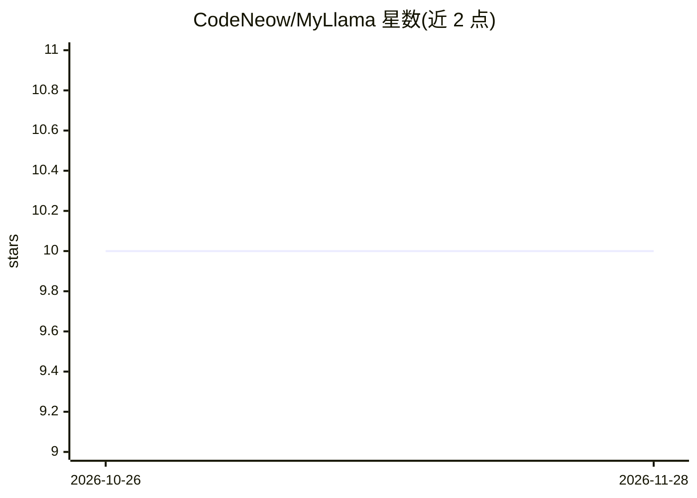

# CodeNeow/MyLlama

⭐ 10 · Go · GPL-3.0 · 推送 2026-09-17 · [GitHub](https://github.com/CodeNeow/MyLlama) · 个人维护 · 中文 README

**给个人用户的跨平台本地大模型客户端与 OpenAI 端点管理器**

基于 llama.cpp 的本地大模型客户端：扫描本地 GGUF 文件并解析元数据，可视化配置推理参数，或读取模型层数/注意力头等指标结合硬件快照与实测内存带宽生成一键调优方案；llama-server 以路由模式把目录下所有 GGUF 汇聚成一个 OpenAI 兼容端点，供内置聊天与任意 OpenAI 客户端使用。内置 HF 镜像/Hugging Face/ModelScope 三源模型下载（断点续传）、本地流式聊天、tok/s 与 GPU/内存/CPU 实时监控，数据全部留在本机。提供 Windows/Linux/Android 预构建包，GPL-3.0。

## 筛选速览

| 维度 | 判定 | 备注 |
|---|---|---|
| AI 角色 | `ai-ecosystem` | LLM/agent 周边工具 |
| 许可风险 | `viral` | GPL-3.0 |
| 部署形态 | `desktop` | 安装包/桌面程序 |
| 模型依赖 | local-ok | 支持本地模型 |
| 硬件要求 | — | 无带数字的原话,不猜 |
| 安装摩擦 | `medium` | 含编译或系统依赖之一 |
| 成熟度 | — | 结构信号不足 |

## 能力要点

- 读取 GGUF 元数据与硬件快照，自动规划四档 offload 推理策略
- llama-server 路由模式：多模型共享一个 OpenAI 兼容端点，按需懒加载/卸载
- HF 镜像/Hugging Face/ModelScope 三源下载与断点续传队列
- tok/s 双指标、GPU/内存/CPU 实时采样与增量日志监控

## 适用场景

- 在本机离线运行 GGUF 模型并保持数据不出本机
- 为其他 OpenAI 兼容客户端提供本地多模型端点
- 在一键调优后按硬件选择合适的推理参数
- 在 Windows/Linux/Android 上管理本地模型下载与服务

## 场景标签

`推理引擎` `聊天机器人` · 领域:对话与助手

## 证据(README 行号)

> L7: 基于 llama.cpp 的跨平台本地大模型客户端：扫描本地 GGUF → 可视化配置推理参数（或一键智能调优）→ 生成 llama-server 预设 → 一个 OpenAI 兼容端点，供内置聊天与任意客户端使用。模型下载、本地聊
> L38: llama-server 以路由模式运行，目录下所有 GGUF 汇聚成一个 OpenAI 兼容端点：模型按需懒加载、空闲一键卸载，任意 OpenAI 客户端即插即用。
> L218: 前端是 Vue 3 单页应用，经 Wails v3 桥接（构建时生成的 TypeScript bindings）调用 Go 后端；同一套前端分别渲染在 Windows 的 WebView2、Linux 的 WebKitGTK 与

## 星数曲线

2026-10-26 10 → 2026-11-28 10（+0）

---
*卡片 v1 · prompt 1.4 · 生成 2026-11-20 · 置信度 high · 依据 README sha `1dc27ed74db1` · [字段定义](../../DATASET.md)*
