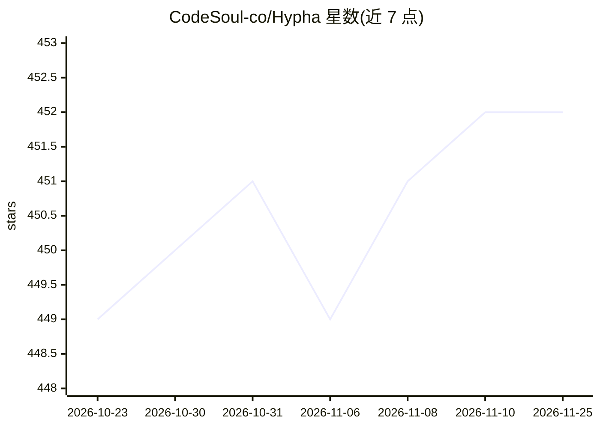

# CodeSoul-co/Hypha

⭐ 452 · TypeScript · Apache-2.0 · 推送 2026-11-15 · [GitHub](https://github.com/CodeSoul-co/Hypha) · [官网](https://codesoul-co.github.io/Hypha/) · 组织维护 · 中文 README

**面向生产级 LLM agent 应用的 TypeScript 框架**

hypha 是一个 TypeScript 开源框架，由 Agent Core 与 Production Harness 两层构成：Core 负责推理/ReAct、规划、工具选择、Memory 访问与模型编排；Harness 通过 FSM、事件与检查点实现受控执行、策略审批、恢复、重放与审计。业务行为通过 DomainPack 声明编译进共享运行时，另有 Cache & Reuse 平面复用推理、工具、Memory 与 KV 前缀等结果。运行需 Node.js 22+、MongoDB 与 Redis，提供 API 服务器与 CLI 两种使用面。

## 筛选速览

| 维度 | 判定 | 备注 |
|---|---|---|
| AI 角色 | `ai-ecosystem` | LLM/agent 周边工具 |
| 许可风险 | `permissive` | Apache-2.0 |
| 部署形态 | `self-host` | docker 或自建部署 |
| 模型依赖 | — | README 未给出锁定关系 |
| 硬件要求 | — | 无带数字的原话,不猜 |
| 安装摩擦 | `low` | 无编译、无系统依赖或容器化 |
| 成熟度 | — | 结构信号不足 |

## 能力要点

- Agent Core + Production Harness 双层架构，事件溯源支持恢复/重放/审计
- 分层缓存体系（Serving/Thinking/WorkCache/Prefix-KV 等）与语义缓存树
- DomainPack 声明式配置：任务、工作流、策略、评估、输出契约
- 同一运行时可实例化不同领域 agent（编码/金融/法律/研究）

## 适用场景

- 构建需要审批、恢复与审计的生产级 agent 应用
- 用同一运行时派发多个领域 agent 产品
- 通过缓存复用降低推理成本与延迟
- 基于事件回放做回归测试与行为审计

## 场景标签

`Agent 框架` `Agent 记忆` · 领域:Agent 开发

## 证据(README 行号)

> L18: hypha is an open-source TypeScript framework built around two cooperating layers: an **Agent Core**
> L21: event-backed execution with FSM control, policy/approval, checkpoints, recovery, replay, and audit.
> L143: |Runtime|ReAct + FSM, durable session commands, bounded continuation, timers, leases, fencing, cancellation, recov

## 星数曲线

2026-10-23 449 → 2026-11-25 452（+3）

---
*卡片 v1 · prompt 1.4 · 生成 2026-11-25 · 置信度 mid · 依据 README sha `24bb26a9c8f1` · [字段定义](../../DATASET.md)*
