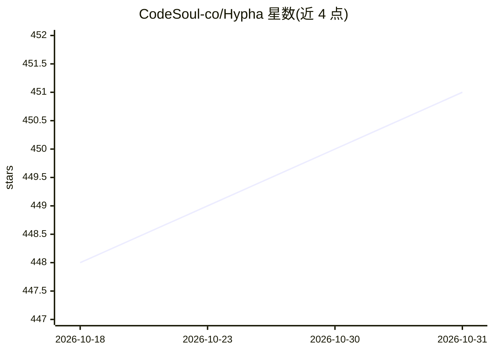

# CodeSoul-co/Hypha

⭐ 451 · TypeScript · Apache-2.0 · 推送 2026-09-04 · [GitHub](https://github.com/CodeSoul-co/Hypha) · [官网](https://codesoul-co.github.io/Hypha/) · 组织维护 · 中文 README

**TypeScript LLM agent 框架：Agent Core + 生产级 Harness 与缓存复用层**

开源 TypeScript 框架，分 Agent Core（ReAct 推理、规划、工具选择、Memory、模型编排）与 Production Harness（FSM 执行、事件/检查点、策略审批、恢复、回放、审计）两层；产品特定行为以 DomainPack 声明并编译进共享运行时。提供六层缓存（Serving/Thinking/WorkCache/Tool/Memory/Prefix-KV）与类型化缓存树，核心不变量为“复用但不作为权威”。运行需 Node.js 22+、MongoDB、Redis 与至少一个模型提供方，含 Express API server 与示例 CLI，面向构建生产级领域 agent 的开发者。

## 筛选速览

| 维度 | 判定 | 备注 |
|---|---|---|
| AI 角色 | `ai-ecosystem` | LLM/agent 周边工具 |
| 许可风险 | `permissive` | Apache-2.0 |
| 部署形态 | `self-host` | docker 或自建部署 |
| 模型依赖 | — | README 未给出锁定关系 |
| 硬件要求 | — | 无带数字的原话,不猜 |
| 安装摩擦 | `low` | 无编译、无系统依赖或容器化 |
| 成熟度 | — | 结构信号不足 |

## 能力要点

- Agent Core + Production Harness 双层架构，DomainPack 声明式定义任务/策略/评测契约
- 六层缓存复用平面（含 Serving/Thinking/WorkCache/Prefix-KV）与语义缓存树
- FSM 执行、事件溯源、检查点、恢复、回放与审计
- 多种后端适配：Mem0/Vertex AI Memory Bank、SQLite/PostgreSQL/S3、Docker/远程 HTTP 沙箱

## 适用场景

- 构建需要治理、审批与可恢复执行的生产级领域 agent
- 让编码/金融/法律/研究等不同 agent 共享同一 Core+Harness 运行时
- 通过缓存复用平面降低推理成本与延迟

## 场景标签

`Agent 框架` `Agent 记忆` · 领域:Agent 开发

## 证据(README 行号)

> L20: hypha is an open-source TypeScript framework built around two cooperating layers: an **Agent Core**
> L22: access, and model/context orchestration; the Production Harness turns those decisions into bounded,

## 星数曲线

2026-10-18 448 → 2026-10-31 451（+3）

---
*卡片 v1 · prompt 1.4 · 生成 2026-10-22 · 置信度 mid · 依据 README sha `13c461b35457` · [字段定义](../../DATASET.md)*
