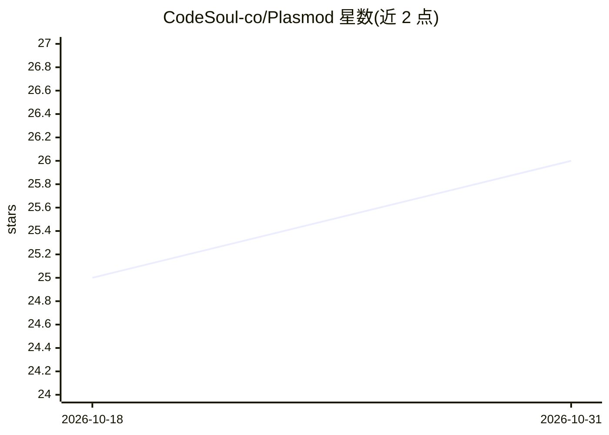

# CodeSoul-co/Plasmod

⭐ 26 · Go · MIT · 推送 2026-10-30 · [GitHub](https://github.com/CodeSoul-co/Plasmod) · [官网](https://plasmod.code-soul.com/) · 组织维护 · 中文 README

**面向 AI agent 的原生数据库：记忆/状态/事件的一等对象与证据检索**

用 Go 编写、提供 Python SDK（pyplasmod）的开源 agent 原生数据库。将 memory、state、event、artifact、relation 建模为一等数据库对象，通过 append-only WAL 支持事件驱动的状态演化、时点查询与审计回放；查询返回包含来源、证明轨迹与 1-hop 图上下文的结构化证据包，而非仅 top-k 片段。内置 workspace/session 多租户隔离与热/温/冷分层存储（冷层为 S3 兼容）。支持 Docker 部署、HTTP API、LangChain 适配器（PlasmodVectorStore）与多种 embedding 提供方（默认 TF-IDF）。另声明将有云端商业版。

## 筛选速览

| 维度 | 判定 | 备注 |
|---|---|---|
| AI 角色 | `ai-ecosystem` | LLM/agent 周边工具 |
| 许可风险 | `permissive` | MIT |
| 部署形态 | `self-host` | docker 或自建部署 |
| 模型依赖 | locked-api |  |
| 硬件要求 | — | 无带数字的原话,不猜 |
| 安装摩擦 | `low` | 无编译、无系统依赖或容器化 |
| 成熟度 | — | 结构信号不足 |

## 能力要点

- Event/Memory/State/Artifact/Edge 一等对象数据模型
- Append-only WAL 支持回放、时点查询与多 agent 冲突检测
- 查询返回含 provenance、证明轨迹与图上下文的结构化证据包
- 热/温/冷三层存储与 workspace/session 多租户隔离

## 适用场景

- 为自主 agent 维护跨会话的长期记忆与状态演化
- RAG 系统返回带来源归属与证明轨迹的检索结果
- 多 agent 协作场景下的隔离记忆与冲突检测
- 需要完整审计轨迹的知识演化追踪

## 场景标签

`Agent 记忆` `向量数据库` · 领域:Agent 开发

## 证据(README 行号)

> L14: Plasmod is an open-source **agent-native database** designed for AI applications and multi-agent systems. It provid
> L18: Plasmod is built for scenarios where agents need more than top-k similarity matches. It supports **event-driven sta
> L20: > **Core thesis:** agent memory, state, event, artifact, and relation should be modeled as first-class database obj

## 星数曲线

2026-10-18 25 → 2026-10-31 26（+1）

---
*卡片 v1 · prompt 1.4 · 生成 2026-10-27 · 置信度 high · 依据 README sha `7868f0da5a6b` · [字段定义](../../DATASET.md)*
