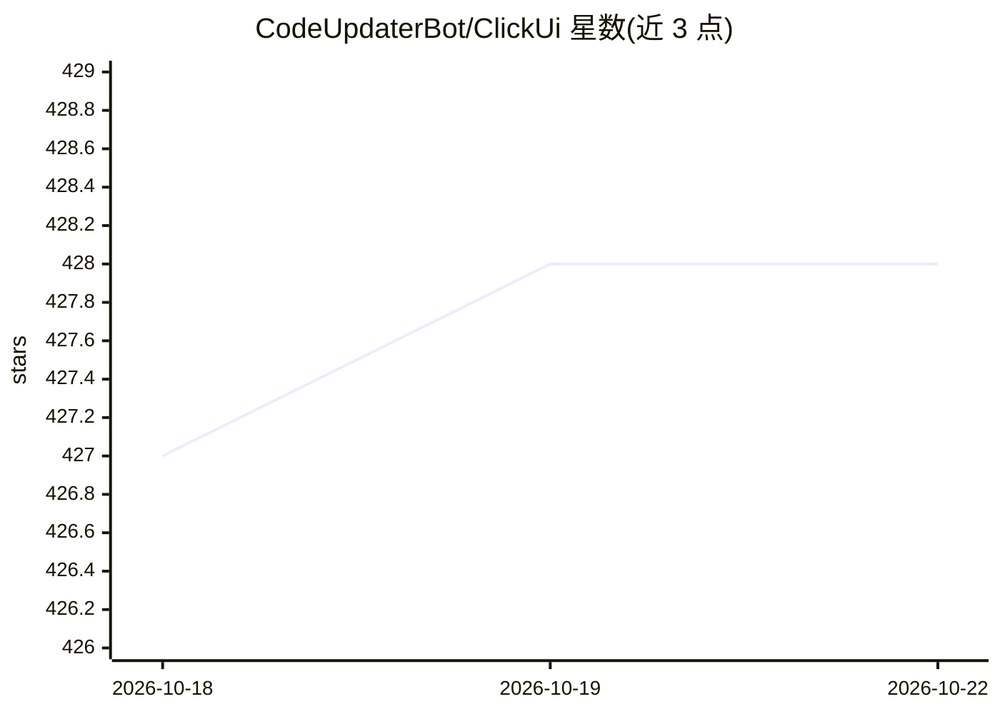

# CodeUpdaterBot/ClickUi

⭐ 428 · Python · AGPL-3.0 · 推送 2026-09-07 · [GitHub](https://github.com/CodeUpdaterBot/ClickUi) · [官网](https://clickui.app) · 个人维护

**桌面 AI 助手应用：语音/文字对话，接入多种模型**

纯 Python 编写的跨平台开源桌面 AI 助手，提供语音模式（Whisper 语音识别 + Kokoro 语音合成，可输出至本地音频或 SONOS 音箱）与 Ctrl+k 呼出的文字聊天界面。支持 OpenAI、Google、Ollama、Claude、Groq、OpenRouter 等多家模型 API，并集成 Google 搜索、Zillow/Redfin 房产估价、文本文件附件等功能。安装需 Conda 环境 + pip 依赖，Windows 提供 Install.bat 脚本；Whisper/Kokoro 模型须预先加载，注释掉后可无语音运行。

## 筛选速览

| 维度 | 判定 | 备注 |
|---|---|---|
| AI 角色 | `ai-native` | 本体是模型或模型工具 |
| 许可风险 | `viral` | AGPL-3.0 |
| 部署形态 | `library` | 以包/库形式分发 |
| 模型依赖 | local-ok | 支持本地模型 |
| 硬件要求 | — | 无带数字的原话,不猜 |
| 安装摩擦 | `medium` | 含编译或系统依赖之一 |
| 成熟度 | — | 结构信号不足 |

## 能力要点

- Whisper 语音识别 + Kokoro 语音合成的语音模式
- 支持 OpenAI/Google/Ollama/Claude/Groq/OpenRouter 多家模型 API
- Ctrl+k 热键呼出的悬浮聊天 UI（PySide6）
- 集成 Google 搜索、Zillow/Redfin 房产估价与文件附件

## 适用场景

- 在电脑上用热键随时唤起 AI 对话或语音交互
- 通过语音命令与 AI 交流并从音箱听取回答
- 聊天中附带文件、搜索网络信息或查询房产估价

## 场景标签

`AI 助手` `语音 Agent` · 领域:对话与助手

## 证据(README 行号)

> L190: The application supports multiple AI models (OpenAI, Google, Ollama, Claude, Groq, and OpenRouter). An example for
> L49: - **Whisper:** An automatic speech recognition (ASR) system used for transcribing voice input.

## 星数曲线

2026-10-18 427 → 2026-10-22 428（+1）

---
*卡片 v1 · prompt 1.4 · 生成 2026-10-21 · 置信度 high · 依据 README sha `7140d2d8763d` · [字段定义](../../DATASET.md)*
