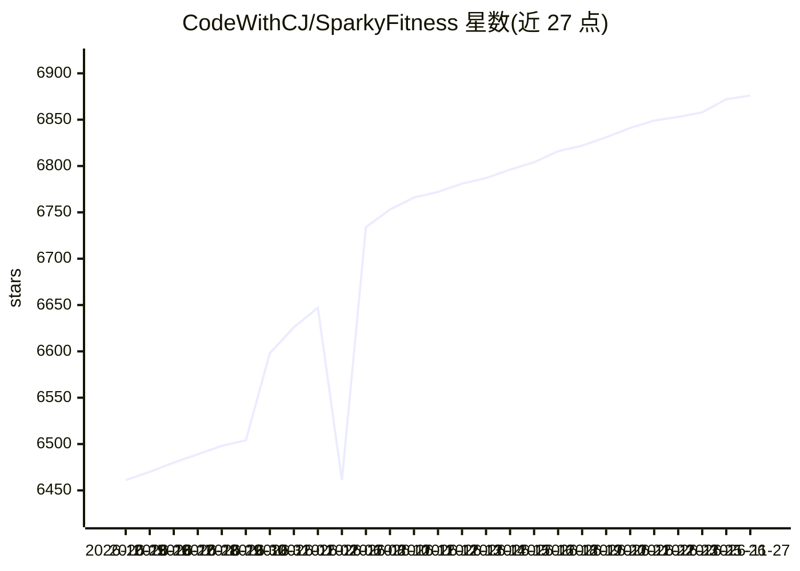

# CodeWithCJ/SparkyFitness

⭐ 6,876 · TypeScript · NOASSERTION · 推送 2026-11-26 · [GitHub](https://github.com/CodeWithCJ/SparkyFitness) · [官网](https://codewithcj.github.io/SparkyFitness/) · 个人维护

**自托管家庭健康追踪平台，可选 AI 聊天记录饮食与运动**

自托管的健身与健康追踪平台，由后端服务、Web 前端、iOS/Android 原生应用及 Apple Watch/Wear OS 伴侣应用组成，数据存储在用户自有基础设施上。功能覆盖营养、运动、饮水、睡眠、禁食、情绪与身体指标追踪，支持多用户与家庭共享、OIDC/TOTP/Passkey 认证，并接入多种可穿戴平台与食物营养数据库。提供可选的 SparkyAI 聊天界面（Beta），通过 BYOK 或本地模型记录数据与查看进度。README 声明其为 source-available 而非开源，许可证禁止商用。

## 筛选速览

| 维度 | 判定 | 备注 |
|---|---|---|
| AI 角色 | `ai-enhanced` | 去掉 AI 部分产品仍成立 |
| 许可风险 | `none` | NOASSERTION |
| 部署形态 | `self-host` | docker 或自建部署 |
| 模型依赖 | local-ok | 支持本地模型 |
| 硬件要求 | — | 无带数字的原话,不猜 |
| 安装摩擦 | `low` | 无编译、无系统依赖或容器化 |
| 成熟度 | `idea` | |

## 能力要点

- 自托管架构：后端 + Web 前端 + 移动应用 + 手表伴侣应用
- 接入 10+ 可穿戴/健康平台与 12+ 食物营养数据库
- SparkyAI 支持 BYOK 与本地模型（Ollama、OpenAI 兼容端点）
- 多用户配置与家庭细粒度权限共享

## 适用场景

- 在自有服务器上记录全家人的饮食与运动数据
- 将手表、体重秤等设备数据汇总到一个平台
- 通过对话或拍照自动记录一餐

## 场景标签

 · 领域:健康/健身追踪

## 证据(README 行号)

> L24: A self-hosted, privacy-first alternative to MyFitnessPal, Flo, Hevy, Shotsy & more. Track nutrition, exercise, body
> L133: ## Optional AI Features (Beta)
> L146: Note: AI features are completely optional.

## 星数曲线

2026-10-25 6,461 → 2026-11-27 6,876（+415）

---
*卡片 v1 · prompt 1.4 · 生成 2026-11-23 · 置信度 high · 依据 README sha `34d7b4acdd33` · [字段定义](../../DATASET.md)*
