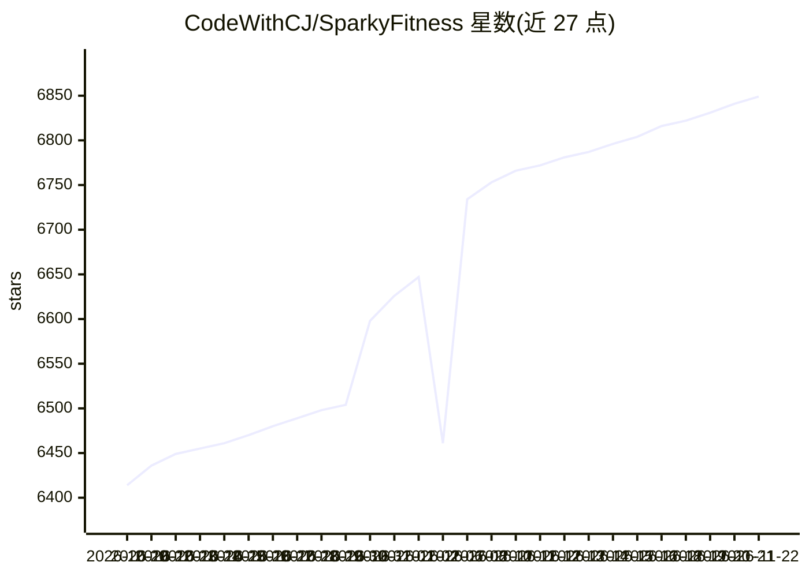

# CodeWithCJ/SparkyFitness

⭐ 6,849 · TypeScript · NOASSERTION · 推送 2026-11-21 · [GitHub](https://github.com/CodeWithCJ/SparkyFitness) · [官网](https://codewithcj.github.io/SparkyFitness/) · 个人维护 · 中文 README

**自托管家庭健康追踪平台，支持 AI 对话记录与多平台数据同步**

由后端服务、Web 前端、iOS/Android 原生应用及 Apple Watch/Wear OS 伴生应用组成的自托管健身追踪平台，数据存储在用户自有基础设施上。核心功能覆盖营养、运动、饮水、睡眠、断食、情绪与身体指标追踪，支持多用户与家庭权限共享，并可从 Apple Health、Fitbit、Garmin 等 20+ 平台同步数据。AI 为可选 Beta 功能：SparkyAI 提供对话式记录饮食/运动、食物图片自动识别记录，需自带 LLM，经 MCP server 接入。许可证为 source-available，非商业用途。

## 筛选速览

| 维度 | 判定 | 备注 |
|---|---|---|
| AI 角色 | `ai-enhanced` | 去掉 AI 部分产品仍成立 |
| 许可风险 | `none` | NOASSERTION |
| 部署形态 | `self-host` | docker 或自建部署 |
| 模型依赖 | — | README 未给出锁定关系 |
| 硬件要求 | — | 无带数字的原话,不猜 |
| 安装摩擦 | `low` | 无编译、无系统依赖或容器化 |
| 成熟度 | `idea` | |

## 能力要点

- 自托管架构：数据存储在用户控制的基础设施上
- 20+ 健康与营养平台数据同步（Apple Health、Fitbit、Garmin、Oura 等）
- 多用户配置与家庭权限共享（7 项细粒度权限）
- 可选 SparkyAI：对话式记录、食物图片识别，经 MCP server + 自带 LLM

## 适用场景

- 家庭共享追踪饮食、运动、睡眠与健康指标
- 聚合多平台可穿戴设备数据到自有服务器
- 通过对话或拍照快速记录一餐饮食

## 场景标签

`聊天机器人` · 领域:对话与助手

## 证据(README 行号)

> L24: A self-hosted, privacy-first alternative to MyFitnessPal, Flo, Hevy, Shotsy & more. Track nutrition, exercise, body
> L109: ## Optional AI Features (Beta)
> L111: SparkyAI provides a conversational interface for logging data and reviewing progress.

## 星数曲线

2026-10-20 6,414 → 2026-11-22 6,849（+435）

---
*卡片 v1 · prompt 1.4 · 生成 2026-11-22 · 置信度 high · 依据 README sha `0ee8431b21a8` · [字段定义](../../DATASET.md)*
