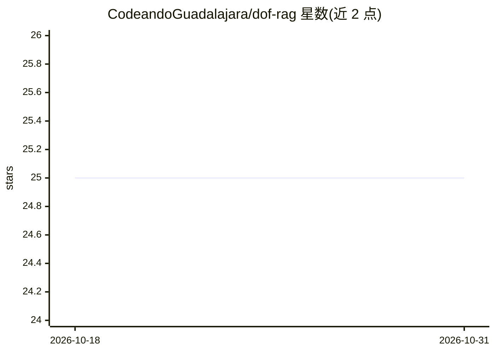

# CodeandoGuadalajara/dof-rag

⭐ 25 · Python · MIT · 推送 2026-10-21 · [GitHub](https://github.com/CodeandoGuadalajara/dof-rag) · [官网](https://codeandoguadalajara.github.io/dof-rag-website/) · 组织维护

**墨西哥联邦公报（DOF）的 RAG 聊天与检索问答系统**

面向墨西哥《联邦官方公报》(DOF) 的对话式问答系统：脚本下载 PDF/Word 格式的公报文档，经 LibreOffice+pandoc 或 OCR（Gemini 2.0 Flash，用于 1999 年前扫描件）转为 Markdown，切块后建 FTS5 BM25 索引与 jina-v5 二进制 embeddings 向量索引。已构建 657,867 文档、673 万 chunks 的语料。Agent 提供工具化检索（词法/向量/混合），配套 42 题人工评估集、带队列与 Clerk 认证的人工评估 Web 应用（Air）及私人聊天界面。支持本地 llama.cpp llama-server 或 Kimi 等提供商，检索模式默认词法、可切换混合。

## 筛选速览

| 维度 | 判定 | 备注 |
|---|---|---|
| AI 角色 | `ai-native` | 本体是模型或模型工具 |
| 许可风险 | `permissive` | MIT |
| 部署形态 | `None` |  |
| 模型依赖 | local-ok | 支持本地模型 |
| 硬件要求 | — | 无带数字的原话,不猜 |
| 安装摩擦 | `low` | 无编译、无系统依赖或容器化 |
| 成熟度 | — | 结构信号不足 |

## 能力要点

- PDF/Word 下载 + OCR/转换 + Markdown 提取 + embeddings 的完整语料管线
- FTS5 BM25 与 vec0 向量索引的混合检索（默认词法，可切 hybrid）
- Agent 工具（搜文档/搜证据/读 chunk）+ 42 题确定性检索评估（MRR 0.339）
- 带 SQLite 队列、Clerk 认证、流式回答与 systemd 部署的人工评估 Web 应用

## 适用场景

- 查询墨西哥联邦公报历史各期的法规内容并获得带证据的回答
- 对公报全文语料做混合检索与人工评估
- 用本地模型（llama.cpp + Qwen）自托管公报问答服务

## 场景标签

`RAG` `文档问答` `OCR` · 领域:知识与检索

## 证据(README 行号)

> L3: dof-rag es un chat y un sistema de consulta por generación aumentada para explorar las ediciones del Diario Oficial 
> L142: - `agent_tools/`: agente de herramientas (buscar documentos, buscar evidencia, leer chunks) con recuperación léxic
> L269: `/` conserva la evaluación de preguntas y respuestas. `/chat` agrega conversaciones

## 星数曲线

2026-10-18 25 → 2026-10-31 25（+0）

---
*卡片 v1 · prompt 1.4 · 生成 2026-10-27 · 置信度 high · 依据 README sha `e05eabf79054` · [字段定义](../../DATASET.md)*
