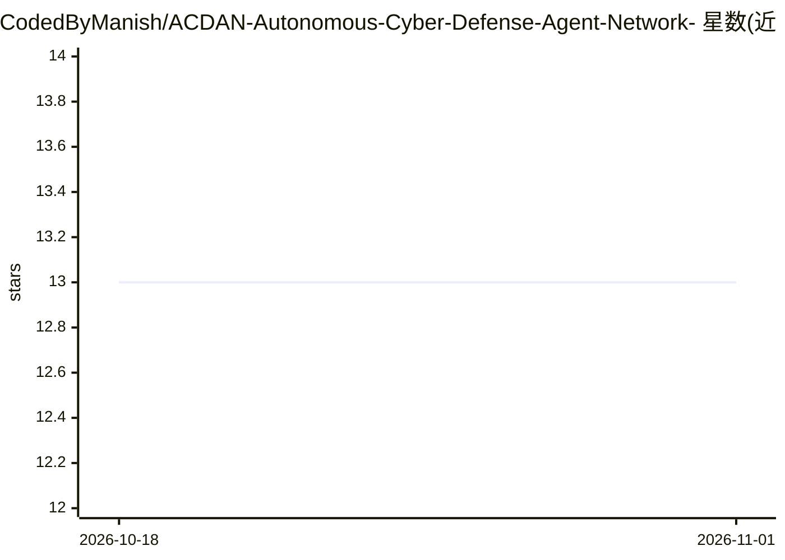

# CodedByManish/ACDAN-Autonomous-Cyber-Defense-Agent-Network-

⭐ 13 · Python · MIT · 推送 2026-04-01 · [GitHub](https://github.com/CodedByManish/ACDAN-Autonomous-Cyber-Defense-Agent-Network-) · 个人维护

**多智能体自主网络防御框架：检测-推理-响应一体化**

端到端多智能体网络安全框架，自动化 Detect-Reason-Response 流程：PyTorch DNN 基于 79 个双向流特征做流量异常检测（86.76% 准确率），RAG（FAISS+Sentence-Transformers）结合 Ollama 上的 Mistral-7B 4-bit 生成威胁摘要与 CVE 交叉引用，DQN 强化学习智能体在 Block/Limit/Alert 中选择缓解策略。后端为 Django + Django Ninja。数据工程脚本将 CIC-IDS-2017 平衡为 87.6 万样本，面向 8GB RAM/4GB VRAM 受限硬件。定位为开源研究项目，需自行训练检测与 RL 模型。

## 筛选速览

| 维度 | 判定 | 备注 |
|---|---|---|
| AI 角色 | `ai-native` | 本体是模型或模型工具 |
| 许可风险 | `permissive` | MIT |
| 部署形态 | `library` | 以包/库形式分发 |
| 模型依赖 | local-ok | 支持本地模型 |
| 硬件要求 | — | 无带数字的原话,不猜 |
| 安装摩擦 | `medium` | 含编译或系统依赖之一 |
| 成熟度 | — | 结构信号不足 |

## 能力要点

- PyTorch DNN 检测（79 个双向流特征，86.76% 准确率）
- RAG + Mistral-7B 4-bit（Ollama）威胁推理与 CVE 交叉引用
- DQN 智能体自主选择 Block/Limit/Alert 缓解策略
- 消费级硬件（8GB RAM/4GB VRAM）数据工程与量化优化

## 适用场景

- 自动化网络入侵检测与威胁分析研究
- 在消费级硬件上复现自主防御流水线
- 作为 RL 网络防御环境做缓解策略学习实验

## 场景标签

`多智能体` `网络安全` `强化学习` · 领域:Agent 开发

## 证据(README 行号)

> L9: - **Adaptive Detection:** PyTorch-based DNN achieving high accuracy on 79 bi-directional flow features.
> L10: - **Contextual Reasoning:** RAG-enabled Mistral LLM (via Ollama) providing expert-level threat summaries and CVE cr
> L11: - **Autonomous Mitigation:** Deep Q-Network (DQN) agent that learns optimal responses (Block/Limit/Alert) based on 

## 星数曲线

2026-10-18 13 → 2026-11-01 13（+0）

---
*卡片 v1 · prompt 1.4 · 生成 2026-10-31 · 置信度 high · 依据 README sha `4179aad13cf7` · [字段定义](../../DATASET.md)*
