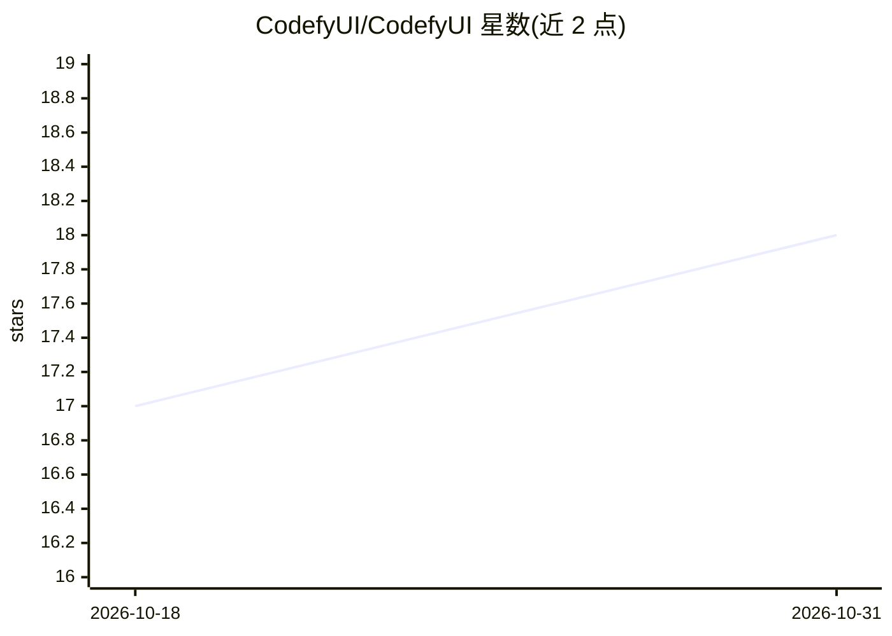

# CodefyUI/CodefyUI

⭐ 18 · Python · AGPL-3.0 · 推送 2026-10-23 · [GitHub](https://github.com/CodefyUI/CodefyUI) · [官网](http://docs.codefyui.com/) · 组织维护 · 中文 README

**面向教育的可视化深度学习流水线搭建器：拖拽节点构建网络**

基于浏览器与节点画布的深度学习流水线构建工具：用户拖拽节点、以类型安全连线组成 DAG，即可设计与执行 CNN、RNN、Transformer 与 RL 架构，无需样板代码。内置 16 类共 158 个节点，提供逐节点输出检查的张量对比教学面板、预设模板、运行队列与参数扫掠、远程 GPU worker、脏节点部分重执行，以及把图发布为带 API key 的 HTTP 端点。前端 React 19，后端 Python 3.10+ / FastAPI / PyTorch；一行脚本安装后以 cdui 命令管理。

## 筛选速览

| 维度 | 判定 | 备注 |
|---|---|---|
| AI 角色 | `ai-ecosystem` | LLM/agent 周边工具 |
| 许可风险 | `viral` | AGPL-3.0 |
| 部署形态 | `library` | 以包/库形式分发 |
| 模型依赖 | — | README 未给出锁定关系 |
| 硬件要求 | — | 无带数字的原话,不猜 |
| 安装摩擦 | `medium` | 含编译或系统依赖之一 |
| 成熟度 | — | 结构信号不足 |

## 能力要点

- 拖拽节点组成 DAG 并执行，含 CNN/RNN/Transformer/RL 共 16 类 158 个内置节点
- Teaching Inspector 逐节点记录输出并并排对比输入→输出张量
- 运行队列、参数扫掠（POST /api/sweeps）与远程 GPU worker 执行
- 脏节点跟踪只重跑变更节点及其下游依赖

## 适用场景

- 在课堂上不用写代码就搭建和讲解神经网络结构
- 设计 CNN/Transformer/RL 实验并做参数扫掠
- 把训练好的流水线发布为 HTTP API 端点供调用

## 场景标签

 · 领域:深度学习/教育工具

## 证据(README 行号)

> L6: A visual, node-based deep learning pipeline builder. Design CNN, RNN, Transformer, and RL architectures by dragging 
> L15: - **158 Built-in Nodes** across 16 categories (CNN, RNN, Transformer, RL, Data, Data Flow, Training, IO, Control, U

## 星数曲线

2026-10-18 17 → 2026-10-31 18（+1）

---
*卡片 v1 · prompt 1.4 · 生成 2026-10-30 · 置信度 mid · 依据 README sha `11911eac9697` · [字段定义](../../DATASET.md)*
