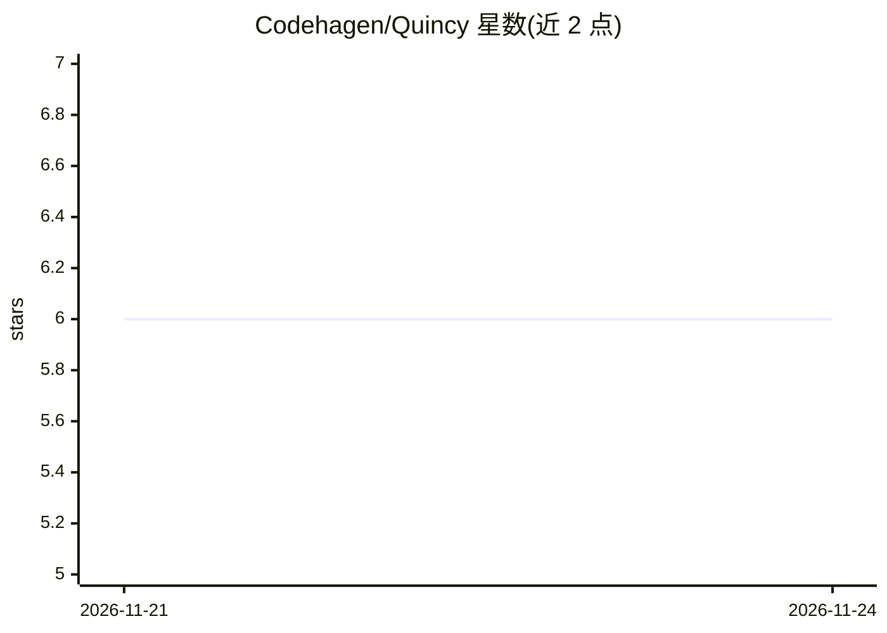

# Codehagen/Quincy

⭐ 6 · TypeScript · AGPL-3.0 · 推送 2026-11-19 · [GitHub](https://github.com/Codehagen/Quincy) · [官网](https://hirequincy.com) · 个人维护

**面向内容创作者的 AI 内容主管 agent：从素材生成各渠道草稿并发布**

Quincy 是一个自托管的 Next.js 应用，定位为 AI 内容主管：用户合并 pull request、录语音、给通话记录后，它读取素材并为每个渠道起草帖子，草稿需人工 Approve 后才发布到 X 与 LinkedIn。核心机制包括来源素材池、按素材生成的 Ideas、三段式草稿结构、发布节奏的定时任务，以及记录作者语气的可编辑 Brain 页面；对外暴露 MCP 只读接口供其他 agent 读取，但无批准/发布权限。发布调度依赖 cron，Vercel Hobby 计划每天仅执行一次，需外部调度器或 Pro 计划。

## 筛选速览

| 维度 | 判定 | 备注 |
|---|---|---|
| AI 角色 | `ai-native` | 本体是模型或模型工具 |
| 许可风险 | `viral` | AGPL-3.0 |
| 部署形态 | `library` | 以包/库形式分发 |
| 模型依赖 | — | README 未给出锁定关系 |
| 硬件要求 | — | 无带数字的原话,不猜 |
| 安装摩擦 | `medium` | 含编译或系统依赖之一 |
| 成熟度 | — | 结构信号不足 |

## 能力要点

- 读取语音笔记、GitHub PR、通话记录等素材并按渠道生成草稿
- 草稿需人工 Approve 后才发布，MCP 接口只读不可发布
- Brain 页面以可读可编辑的页面记录作者语气
- 支持 X 与 LinkedIn 发布及每渠道改写

## 适用场景

- 把日常开发与会议素材自动转成社媒内容草稿
- 以固定语气批量维护 X 和 LinkedIn 的内容发布
- 自托管一套带审批流程的内容排期工具

## 场景标签

`AI 写作` · 领域:内容生成

## 证据(README 行号)

> L18: Quincy is an AI agent that does the job of a Head of Content. You do the work:
> L20: when there is a post in it, drafts one in your voice for each channel. Then it
> L122: - AI SDK through the Vercel AI Gateway

## 星数曲线

2026-11-21 6 → 2026-11-24 6（+0）

---
*卡片 v1 · prompt 1.4 · 生成 2026-11-21 · 置信度 mid · 依据 README sha `f9f5ada9e4f8` · [字段定义](../../DATASET.md)*
