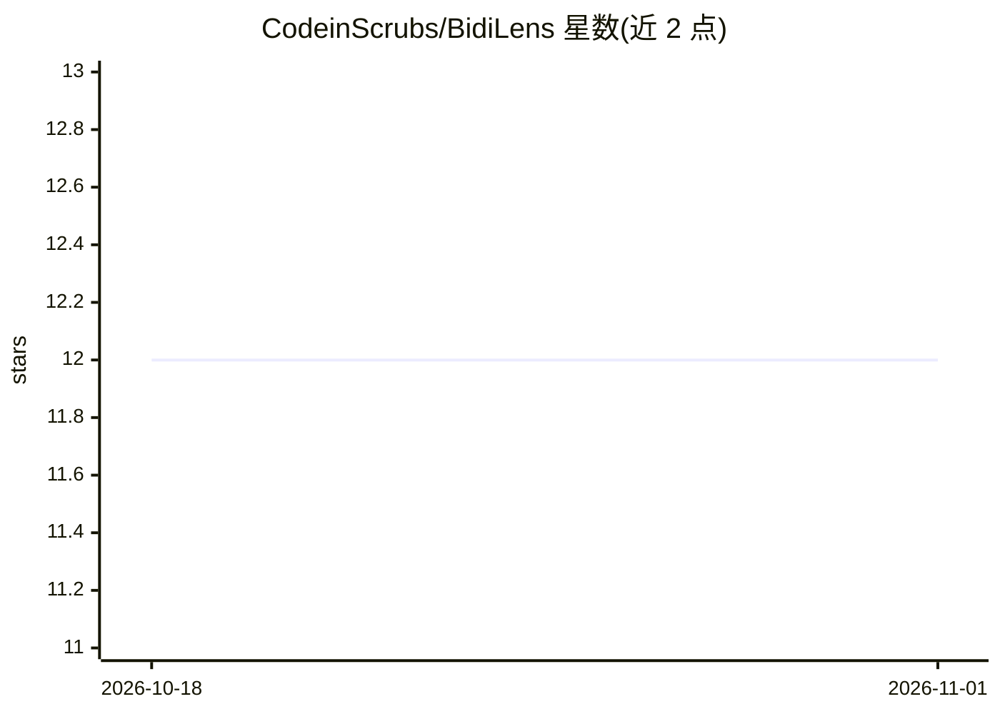

# CodeinScrubs/BidiLens

⭐ 12 · TypeScript · MIT · 推送 2026-10-21 · [GitHub](https://github.com/CodeinScrubs/BidiLens) · [官网](https://codeinscrubs.github.io/BidiLens/) · 组织维护 · 中文 README

**保留源序的 RTL/LTR 混排文本工具包：供 AI 聊天等界面正确渲染**

离线、标准优先的混合方向文本工具集：为 AI 聊天界面、Markdown 渲染器、流式输出、Web 与 Android 应用提供逐块基础方向判定、语义内联隔离、流式稳定状态与隐藏 bidi 控制字符审计。不反转字符串、不替换 Unicode 双向算法，默认 content-majority 策略基于确定性 Unicode 证据（无 LLM、无网络）。JS/Web 12 个 npm 包与 Android Maven 库已发布；Swift、.NET、Rust 仅有源码级集成、未发布到 registry。

## 筛选速览

| 维度 | 判定 | 备注 |
|---|---|---|
| AI 角色 | `ai-ecosystem` | LLM/agent 周边工具 |
| 许可风险 | `permissive` | MIT |
| 部署形态 | `library` | 以包/库形式分发 |
| 模型依赖 | — | README 未给出锁定关系 |
| 硬件要求 | — | 无带数字的原话,不猜 |
| 安装摩擦 | `medium` | 含编译或系统依赖之一 |
| 成熟度 | — | 结构信号不足 |

## 能力要点

- 逐块方向策略（content-majority 等 6 种）与技术 token 识别与内联隔离
- 不修改源文本，仅生成语义标记与隔离方案
- 隐藏 bidi 控制字符审计，SARIF 兼容诊断，Trojan-Source 类风险检查
- 932 个 schema 校验方向 fixture，覆盖 React/Vue/Svelte/DOM/Web Component 与 Android Compose

## 适用场景

- AI 聊天界面渲染波斯语/阿拉伯语/希伯来语与英文混排的模型输出
- Markdown 渲染器中代码、链接、表格与混排文字的正确显示
- 审计文本中不可见 bidi 控制字符带来的安全风险

## 场景标签

 · 领域:i18n/文本渲染基础设施

## 证据(README 行号)

> L79: BidiLens is an offline, standards-first toolkit for mixed right-to-left and
> L147: - AI chat and assistant interfaces rendering multilingual model output;

## 星数曲线

2026-10-18 12 → 2026-11-01 12（+0）

---
*卡片 v1 · prompt 1.4 · 生成 2026-11-01 · 置信度 mid · 依据 README sha `119a45150989` · [字段定义](../../DATASET.md)*
