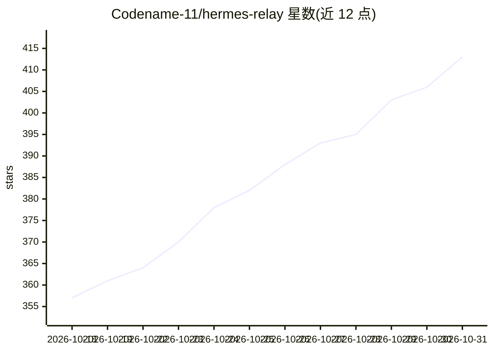

# Codename-11/hermes-relay

⭐ 413 · Kotlin · MIT · 推送 2026-10-26 · [GitHub](https://github.com/Codename-11/hermes-relay) · [官网](https://hermes-relay.dev) · 个人维护 · 中文 README

**Android/桌面客户端：把自托管 Hermes AI agent 带到手机与任意配对机器**

面向自托管 hermes-agent 用户的原生 Android 伴侣应用与单文件桌面 CLI：手机端提供流式聊天、免提语音、模型/密钥/技能/档案管理仪表盘；CLI（beta）通过同一 WSS relay 让 agent 在配对机器上调用文件、终端、搜索、截图等工具，受一次性同意门与 kill-switch 约束。标准路径依赖上游 Dashboard/Gateway（LAN/Tailscale/反代可达），可选 Relay 插件补充 Terminal/TUI、通知与设备控制（仅侧载版，含应用黑名单与活动日志）。Android 需 8.0+，插件安装需 Python 3.11+。

## 筛选速览

| 维度 | 判定 | 备注 |
|---|---|---|
| AI 角色 | `ai-ecosystem` | LLM/agent 周边工具 |
| 许可风险 | `permissive` | MIT |
| 部署形态 | `None` |  |
| 模型依赖 | — | README 未给出锁定关系 |
| 硬件要求 | — | 无带数字的原话,不猜 |
| 安装摩擦 | `low` | 无编译、无系统依赖或容器化 |
| 成熟度 | `idea` | |

## 能力要点

- 流式聊天、免提语音与原生 Hermes 管理仪表盘（模型/密钥/技能/SOUL.md）
- 桌面 CLI 让 agent 在配对机器执行文件/终端/搜索/截图工具，带同意门与 --no-tools 开关
- 多服务器连接与按会话叠加 profile，LAN/Tailscale 自动路由漫游
- QR 一次性配对、Keystore 会话存储、TOFU 证书固定与时间受限授权

## 适用场景

- 在手机上随时与我自托管在家庭机器上的 Hermes agent 对话和管理它
- 出门在外通过 Tailscale 路由继续访问 agent
- 让 agent 经 CLI 在我的电脑上读写文件、执行终端命令（需授权）

## 场景标签

`语音 Agent` `AI 助手` · 领域:对话与助手

## 证据(README 行号)

> L30: Hermes-Relay puts your Hermes agent on the devices you actually carry. The brain stays on your own machine — Hermes
> L33: - **⌨️ Hermes-Relay CLI** *(beta)* — a single binary that gives the agent **hands on any machine you pair**: files,
> L168: - **Streaming chat** — rides vanilla Hermes, preferring the dashboard gateway (`/api/ws`, live thinking) when sign

## 星数曲线

2026-10-18 357 → 2026-10-31 413（+56）

---
*卡片 v1 · prompt 1.4 · 生成 2026-10-21 · 置信度 high · 依据 README sha `1da2af1a0aaa` · [字段定义](../../DATASET.md)*
