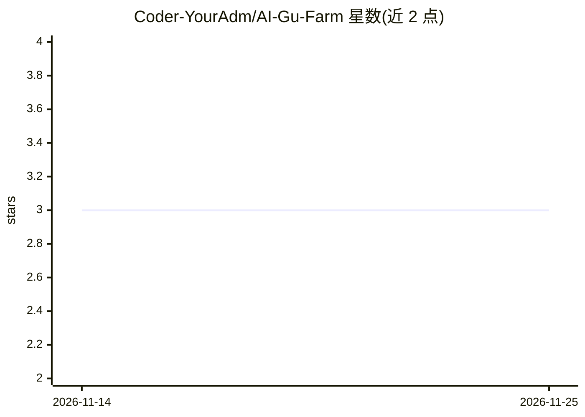

# Coder-YourAdm/AI-Gu-Farm

⭐ 3 · Python · 推送 2026-11-15 · [GitHub](https://github.com/Coder-YourAdm/AI-Gu-Farm) · 组织维护 · 中文 README

**考研数学 AI 助教：演化 prompt 教法并按掌握度出题讲解**

黑客松项目，分两阶段：训练期让 6 个 prompt 个体互出题互解题、20 代演化，判分用本地 Fraction 精确算术而非 LLM 裁判，产物冻结为 profile 文件；运行期是一个考研数学助教，用 BKT 估计掌握度、五级提示梯度与证据链记忆，学生每答一题即判分并更新画像。面向真实学生与演示评委。限制：仅覆盖答案可精确复核的三个知识点（定积分/反常积分/行列式），正式演化未观察到可靠策略改善。提供离线回放演示与实时接口两种模式。

## 筛选速览

| 维度 | 判定 | 备注 |
|---|---|---|
| AI 角色 | `ai-native` | 本体是模型或模型工具 |
| 许可风险 | `none` | — |
| 部署形态 | `library` | 以包/库形式分发 |
| 模型依赖 | — | README 未给出锁定关系 |
| 硬件要求 | — | 无带数字的原话,不猜 |
| 安装摩擦 | `low` | 无编译、无系统依赖或容器化 |
| 成熟度 | `idea` | |

## 能力要点

- 判分走本地 Fraction 精确算术，right/wrong/unanswered 三态区分拒答与算错
- BKT 掌握度 + 五级提示 + 「为什么给你这道题」证据链记忆
- 回放模式断网可演示，实时模式走 /api/ask 本地接口
- 白名单下发题目字段，reference 答案不外发

## 适用场景

- 备考考研数学时按掌握度练习与获得分级提示
- 在无网络环境下离线回放演示助教对话
- 研究 prompt 演化与知识追踪的教学实验参考

## 场景标签

`AI 助手` · 领域:对话与助手

## 证据(README 行号)

> L17: # AI 养蛊机 · Prompt Evolver → 日新 · 智慧考研助教
> L27: 配上掌握度估计、五级提示和带证据的记忆，交给一个 AI 去服务真实学生：
> L61: |依赖|模型（出题 / 解题）|**本地引擎**，模型只负责把下一步说成人话|

## 星数曲线

2026-11-14 3 → 2026-11-25 3（+0）

---
*卡片 v1 · prompt 1.4 · 生成 2026-11-22 · 置信度 mid · 依据 README sha `4e03d0585df6` · [字段定义](../../DATASET.md)*
