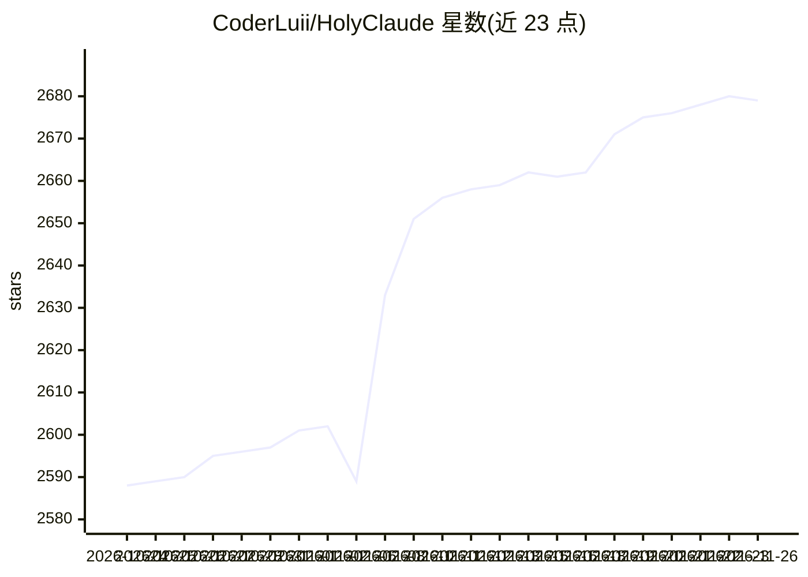

# CoderLuii/HolyClaude

⭐ 2,679 · JavaScript · MIT · 推送 2026-11-22 · [GitHub](https://github.com/CoderLuii/HolyClaude) · [官网](https://holyclaude.coderluii.dev) · 个人维护

**面向开发者的 Docker 容器化 AI 编码工作站：一站式预装 Claude Code 与多个 AI CLI**

以 Docker 镜像形式分发的开发环境容器：预装 Claude Code CLI、Web UI（CloudCLI）、8 个 AI 编码 CLI、Playwright 配置的 Chromium 无头浏览器及 50+ 开发工具，通过 docker compose 一条命令启动，浏览器访问端口 3001 使用。直接运行官方 Claude Code CLI，支持 Claude Max/Pro 订阅 OAuth 或 Anthropic API key 认证，不中转凭证。提供 Full 与 slim 两种镜像变体，支持 AMD64/ARM64、NAS 与 WSL2，内置 s6-overlay 进程管理与 bind mount 持久化。托管云端版本为付费服务。

## 筛选速览

| 维度 | 判定 | 备注 |
|---|---|---|
| AI 角色 | `ai-ecosystem` | LLM/agent 周边工具 |
| 许可风险 | `permissive` | MIT |
| 部署形态 | `self-host` | docker 或自建部署 |
| 模型依赖 | locked-api |  |
| 硬件要求 | — | 无带数字的原话,不猜 |
| 安装摩擦 | `low` | 无编译、无系统依赖或容器化 |
| 成熟度 | — | 结构信号不足 |

## 能力要点

- docker compose 一条命令启动，预装 Claude Code、Web UI 与 50+ 工具
- 8 个 AI CLI（Codex、Gemini CLI、Cursor、OpenCode 等）随容器提供
- Chromium + Xvfb + Playwright 无头浏览器已配置（含 shm_size 调优）
- Full/slim 双镜像变体，AMD64 + ARM64 多架构构建

## 适用场景

- 在浏览器中使用 Claude Code 而非终端
- 在 NAS/VPS 上搭建可远程访问的 AI 编码环境
- 避免每次重复手动配置 Chromium、权限、进程守护等容器问题

## 场景标签

`编码 Agent` `浏览器自动化` · 领域:效率与自动化

## 证据(README 行号)

> L25: One command. Full AI development workstation. Claude Code, web UI, headless browser, 8 AI CLIs, 50+ dev tools — con
> L127: |**AI CLIs**|8 providers, one container|Install each one separately across 3 package managers|

## 星数曲线

2026-10-24 2,588 → 2026-11-26 2,679（+91）

---
*卡片 v1 · prompt 1.4 · 生成 2026-11-23 · 置信度 mid · 依据 README sha `2ec2b7869e4c` · [字段定义](../../DATASET.md)*
