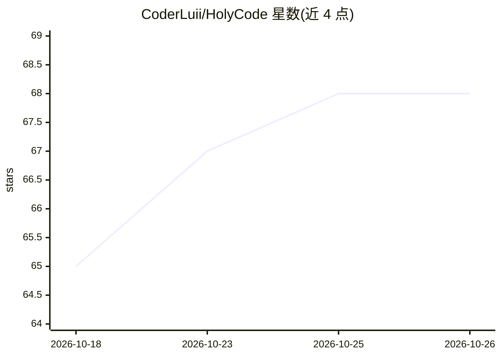

# CoderLuii/HolyCode

⭐ 68 · Python · MIT · 推送 2026-10-22 · [GitHub](https://github.com/CoderLuii/HolyCode) · [官网](https://holycode.cloud) · 个人维护

**容器化 AI 编码工作站：打包 OpenCode 与 50+ 开发工具**

以 Docker 容器形式封装 OpenCode（带 Web UI 的 AI 编码代理）的托管工作站：预装 50+ 开发工具、双语言运行时、沙箱化无头浏览器（Chromium+Xvfb+seccomp）、进程监督，设置与会话通过 bind mount 持久化，支持 PUID/PGID 权限映射。可接入 10+ AI 提供商（Anthropic/OpenAI/Gemini/Groq/Bedrock/Azure/Ollama 等），支持 Claude 订阅登录；可选 Paperclip 代理看板（端口 3100）。另有 HolyCode Cloud 托管服务。multi-arch 支持 amd64/arm64。

## 筛选速览

| 维度 | 判定 | 备注 |
|---|---|---|
| AI 角色 | `ai-ecosystem` | LLM/agent 周边工具 |
| 许可风险 | `permissive` | MIT |
| 部署形态 | `self-host` | docker 或自建部署 |
| 模型依赖 | local-ok | 支持本地模型 |
| 硬件要求 | — | 无带数字的原话,不猜 |
| 安装摩擦 | `low` | 无编译、无系统依赖或容器化 |
| 成熟度 | — | 结构信号不足 |

## 能力要点

- Docker 一键启动的 OpenCode 编码工作站，50+ 预装开发工具
- 10+ AI 提供商接入，含 Claude 订阅认证（无需单独 API key）
- 沙箱化无头浏览器（seccomp profile、setuid sandbox）
- Paperclip 代理看板：雇佣 OpenCode worker 管理多代理任务

## 适用场景

- 换机器或重建容器后快速恢复完整 AI 编码环境
- 在任意设备上通过浏览器使用预配置好的编码代理
- 在隔离容器中运行多提供商模型的编码代理与浏览器自动化

## 场景标签

`编码 Agent` · 领域:编码与开发

## 证据(README 行号)

> L23: OpenCode running in a container with everything already installed. 50+ dev tools, 10+ AI providers, a sandboxed hea
> L45: It wraps OpenCode, an AI coding agent with a built-in web UI. All your settings, sessions, MCP configs, plugins, an
> L143: OpenCode is provider-agnostic. Set whichever API key you use and you're done.

## 星数曲线

2026-10-18 65 → 2026-10-26 68（+3）

---
*卡片 v1 · prompt 1.4 · 生成 2026-10-24 · 置信度 mid · 依据 README sha `c992fc84c846` · [字段定义](../../DATASET.md)*
