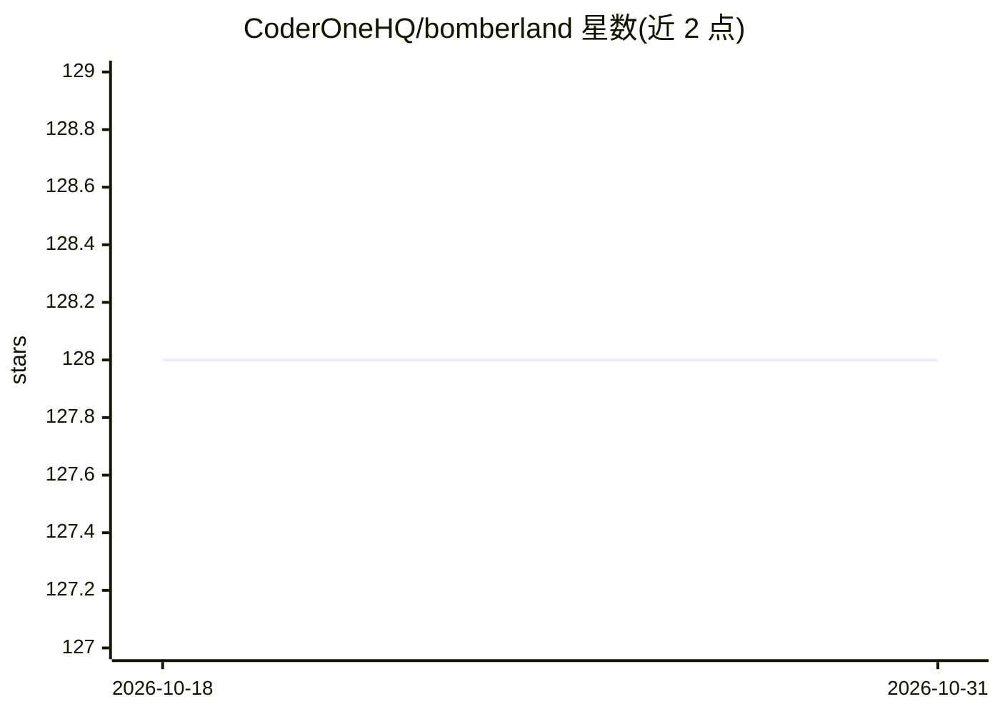

# CoderOneHQ/bomberland

⭐ 128 · C++ · MIT · 推送 2026-07-25 · [GitHub](https://github.com/CoderOneHQ/bomberland) · [官网](https://www.coderone.dev/bomberland/) · 组织维护

**Bomberman 风格多智能体 AI 竞赛引擎与入门套件**

受经典游戏 Bomberman 启发的多智能体 AI 竞赛项目：提供 2D 网格世界游戏引擎，参赛者编写智能体（可用树搜索到深度强化学习等策略）收集道具并放置炸药击败对手。仓库包含引擎源码及 Python3、TypeScript、Go、C++、Rust 等 8 种语言的入门套件，部分含前向模拟器示例；另有实验性 OpenAI Gym 封装。通过 docker-compose 启动引擎，浏览器访问 localhost:3000 客户端可旁观或人类参战。

## 筛选速览

| 维度 | 判定 | 备注 |
|---|---|---|
| AI 角色 | `ai-ecosystem` | LLM/agent 周边工具 |
| 许可风险 | `permissive` | MIT |
| 部署形态 | `self-host` | docker 或自建部署 |
| 模型依赖 | — | README 未给出锁定关系 |
| 硬件要求 | — | 无带数字的原话,不猜 |
| 安装摩擦 | `low` | 无编译、无系统依赖或容器化 |
| 成熟度 | `idea` | |

## 能力要点

- 多智能体竞赛引擎，支持从树搜索到深度强化学习的策略
- 8 种语言入门套件（Python3/TypeScript/Go/C++/Rust 等）
- 实验性 OpenAI Gym 封装供强化学习使用
- 浏览器客户端支持旁观与人类玩家参战

## 适用场景

- 参加多智能体 AI 竞赛并开发参赛智能体
- 用强化学习/Gym 封装训练游戏智能体
- 本地运行引擎并通过客户端观战或人机对战

## 场景标签

`多智能体` · 领域:Agent 开发

## 证据(README 行号)

> L7: Bomberland is a multi-agent AI competition inspired by the classic console game Bomberman.
> L9: Teams build intelligent agents using strategies from tree search to deep reinforcement learning. The goal is to comp

## 星数曲线

2026-10-18 128 → 2026-10-31 128（+0）

---
*卡片 v1 · prompt 1.4 · 生成 2026-10-23 · 置信度 high · 依据 README sha `458094a5be56` · [字段定义](../../DATASET.md)*
