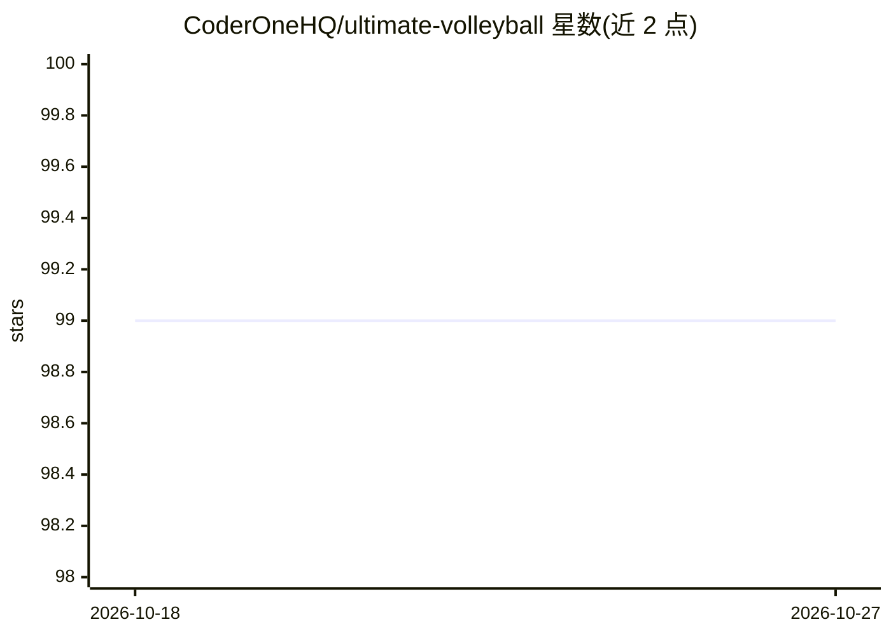

# CoderOneHQ/ultimate-volleyball

⭐ 99 · C# · Apache-2.0 · 推送 2026-06-26 · [GitHub](https://github.com/CoderOneHQ/ultimate-volleyball) · [官网](https://www.coderone.dev/blog/hands-on-introduction-to-deep-reinforcement-learning?s=uvb) · 组织维护

**基于 Unity ML-Agents 的多智能体强化学习排球环境**

在 Unity ML-Agents（Release 19）上构建的 3D 排球多智能体强化学习环境：两方智能体在球场中通过离散动作（前进/旋转/侧移/跳跃共 4 分支）与 11 维观测空间进行对抗，目标是将球打到对方场地。提供奖励函数示例（可在 VolleyballEnvController.cs 中自定义）、self-play 配置文件，以及三个基线模型（随机智能体、PPO 60M 步、PPO Self-Play 60M 步）。用户克隆仓库后在 Unity 编辑器中加载场景即可用基线模型推理运行，或用 mlagents-learn 命令训练。

## 筛选速览

| 维度 | 判定 | 备注 |
|---|---|---|
| AI 角色 | `ai-ecosystem` | LLM/agent 周边工具 |
| 许可风险 | `permissive` | Apache-2.0 |
| 部署形态 | `None` |  |
| 模型依赖 | — | README 未给出锁定关系 |
| 硬件要求 | — | 无带数字的原话,不猜 |
| 安装摩擦 | `low` | 无编译、无系统依赖或容器化 |
| 成熟度 | — | 结构信号不足 |

## 能力要点

- 多智能体 3D 排球环境，4 个离散动作分支、11 维观测空间
- 支持 self-play 训练（含 Volleyball_SelfPlay.yaml 配置文件）
- 附三个 .onnx 基线模型（Random / PPO 60M / PPO Self-Play 60M）
- 奖励函数可在 VolleyballEnvController.cs 的 ResolveEvent() 中自定义

## 适用场景

- 在 Unity 中训练排球对战的强化学习智能体
- 研究 self-play 与 PPO 的多智能体对抗训练
- 学习 Unity ML-Agents 环境搭建（配套微课程）

## 场景标签

`强化学习` · 领域:训练与推理

## 证据(README 行号)

> L6: **Ultimate Volleyball** is a multi-agent reinforcement learning environment built on Unity ML-Agents.
> L26: 4. Run from the command line `mlagents-learn <path to config file> --run-id=<some_id> --time-scale=1`

## 星数曲线

2026-10-18 99 → 2026-10-27 99（+0）

---
*卡片 v1 · prompt 1.4 · 生成 2026-10-23 · 置信度 high · 依据 README sha `ee884214008c` · [字段定义](../../DATASET.md)*
