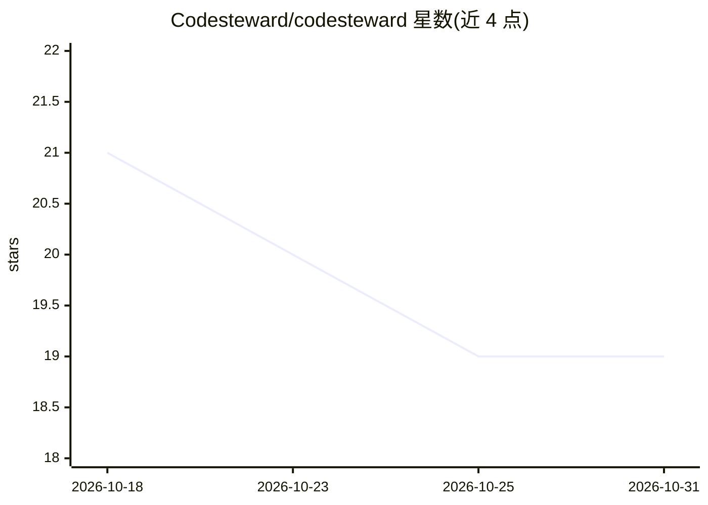

# Codesteward/codesteward

⭐ 19 · TypeScript · Apache-2.0 · 推送 2026-10-27 · [GitHub](https://github.com/Codesteward/codesteward) · [官网](https://docs.codesteward.ai/) · 组织维护

**自托管的 AI 代码评审平台：PR 门禁 + 分支治理**

多 agent 代码评审平台，基于结构化代码图（调用链、依赖、鉴权路径）运行专家评审流水线（专家→验证器→裁判→噪声过滤→门禁结论），支持 PR/MR 门禁与长生命周期分支治理双模式。面向自托管团队：提供产品 UI、CLI、GitHub Action、Webhook 接入，Keycloak OIDC 身份与组织/策略（STEWARD.md、路径规则）管理，多 SCM（GitHub/GitLab/Bitbucket/Azure DevOps/Gitea）与多 LLM provider。部署方式覆盖 Compose/Swarm、Helm 及 AWS/Azure/GCP 一键模板，worker 可水平扩展。Apache-2.0，当前版本 1.5.0。

## 筛选速览

| 维度 | 判定 | 备注 |
|---|---|---|
| AI 角色 | `ai-native` | 本体是模型或模型工具 |
| 许可风险 | `permissive` | Apache-2.0 |
| 部署形态 | `self-host` | docker 或自建部署 |
| 模型依赖 | — | README 未给出锁定关系 |
| 硬件要求 | — | 无带数字的原话,不猜 |
| 安装摩擦 | `low` | 无编译、无系统依赖或容器化 |
| 成熟度 | — | 结构信号不足 |

## 能力要点

- 基于结构代码图（MCP）的多 agent 评审流水线，输出内联评论与门禁结论
- PR 门禁与分支治理双模式共用同一 finding schema 与策略模型
- Keycloak OIDC 身份、组织管理、👍/👎 学习回路与 SCIM 可选支持
- Compose/Swarm、Helm、AWS/Azure/GCP 模板多种自托管部署途径，worker 水平扩展

## 适用场景

- 在 PR/MR 上自动执行代码评审并阻断不合格合并
- 对长生命周期分支做持续评审与 findings 生命周期管理
- 团队自托管代码评审平台，按组织配置评审策略与规则

## 场景标签

`代码审查` `多智能体` · 领域:Agent 开发

## 证据(README 行号)

> L29: Most AI review tools skim a diff and guess. **Codesteward** runs multi-agent reviews against a **structural code gr
> L149: Specialists (correctness, security, performance, testing, rules, …) → optional discourse (thorough) → verifier → j

## 星数曲线

2026-10-18 21 → 2026-10-31 19（-2）

---
*卡片 v1 · prompt 1.4 · 生成 2026-10-29 · 置信度 mid · 依据 README sha `b5f92beedd68` · [字段定义](../../DATASET.md)*
