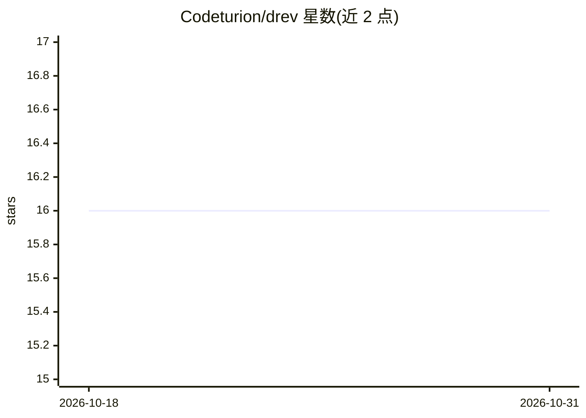

# Codeturion/drev

⭐ 16 · TypeScript · MIT · 推送 2026-05-23 · [GitHub](https://github.com/Codeturion/drev) · [官网](https://fuatcankoseoglu.com/drev) · 个人维护

**让 Claude Code 会话可移植：分享给队友或跨机器续接**

面向使用 Claude Code 的开发团队的 npm CLI 工具：把 Claude Code 会话 JSONL 存入团队 Git 仓库，实现保存、分享与跨机器续接。机制包括路径重写以适配接收方机器与 OS 差异、推送前自动脱敏常见密钥、通过 --resume 续接完整转录、可选导出自包含 HTML 转录给非 Claude 用户。附带 Claude Code 技能与 SessionEnd 钩子实现自然语言操作与自动分享，钩子可靠性被声明为已知问题（v0 阶段）。需要 Node ≥20、git 和 gh CLI，支持非 GitHub 主机。

## 筛选速览

| 维度 | 判定 | 备注 |
|---|---|---|
| AI 角色 | `ai-ecosystem` | LLM/agent 周边工具 |
| 许可风险 | `permissive` | MIT |
| 部署形态 | `library` | 以包/库形式分发 |
| 模型依赖 | — | README 未给出锁定关系 |
| 硬件要求 | — | 无带数字的原话,不猜 |
| 安装摩擦 | `low` | 无编译、无系统依赖或容器化 |
| 成熟度 | `idea` | |

## 能力要点

- 会话保存到团队 Git 仓库并跨机器/跨 OS 路径重写后续接
- 推送前自动脱敏密钥，drev scrub 可重写历史清除泄漏
- 导出自包含 HTML 转录供无 Claude Code 的审阅者查看
- 内嵌 Claude Code 技能与 SessionEnd 钩子支持自然语言命令与自动分享

## 适用场景

- 把调试会话交接给队友，对方续接完整上下文继续工作
- 在工作机与家用机之间迁移未完成的 Claude Code 会话
- 把会话转录导出为 HTML 附加到工单或 wiki 供 PM/设计审阅

## 场景标签

 · 领域:开发者工具/AI 会话协作

## 证据(README 行号)

> L13: **Drev makes Claude Code sessions portable: share one with a friend or teammate, or resume it yourself on any machi
> L19: The bundled Claude Code skill makes the flow feel native: just say *"save this session as foo"* and Claude runs `dr
> L71: Drev pulls the latest, rewrites every path from your machine to theirs (including the OS conventions if you're on d

## 星数曲线

2026-10-18 16 → 2026-10-31 16（+0）

---
*卡片 v1 · prompt 1.4 · 生成 2026-10-30 · 置信度 high · 依据 README sha `90c95c2ca0eb` · [字段定义](../../DATASET.md)*
