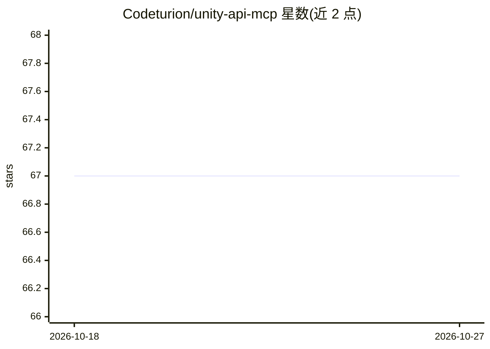

# Codeturion/unity-api-mcp

⭐ 67 · Python · MIT · 推送 2026-10-12 · [GitHub](https://github.com/Codeturion/unity-api-mcp) · [官网](https://www.fuatcankoseoglu.com/) · 个人维护

**为 AI agent 提供 Unity API 文档查询的 MCP 服务器**

面向 MCP 兼容 AI 工具（Claude Code、Cursor、Windsurf）的 Unity API 文档查询服务器，提供 5 个工具：关键词搜索 API、精确方法签名（含重载）、命名空间解析、类参考卡与废弃警告查询。覆盖 Unity 6/2023/2022 LTS 的全部 UnityEngine/UnityEditor 模块及 Input System、Addressables 等包（每个 Unity 6 库约 42,500 条记录）。按版本分库：首次运行下载约 20-30 MB SQLite 数据库到本地，查询响应 <15ms；支持从项目 ProjectVersion.txt 自动检测版本，每周自动构建新版本数据库。不以 Unity 安装为前提；不覆盖 DOTween 等第三方库。可通过 pip 或 MCP 配置中的 uvx 安装，需 Python 3.10+。

## 筛选速览

| 维度 | 判定 | 备注 |
|---|---|---|
| AI 角色 | `ai-ecosystem` | LLM/agent 周边工具 |
| 许可风险 | `permissive` | MIT |
| 部署形态 | `desktop` | 安装包/桌面程序 |
| 模型依赖 | — | README 未给出锁定关系 |
| 硬件要求 | — | 无带数字的原话,不猜 |
| 安装摩擦 | `low` | 无编译、无系统依赖或容器化 |
| 成熟度 | — | 结构信号不足 |

## 能力要点

- 5 个 MCP 工具：API 搜索、方法签名、命名空间解析、类参考、废弃警告
- 每个 Unity 版本独立 SQLite 数据库，约 42,500 条记录/库，查询 <15ms
- 支持从 ProjectVersion.txt 自动检测 Unity 版本
- 数据库每周一自动检测并构建，已装库启动时做新鲜度检查

## 适用场景

- 在 Claude Code/Cursor 等 agent 中查证 Unity API 签名与命名空间，避免编造
- 查询 API 在特定 Unity 版本中的废弃状态
- 离线查阅 Unity 6/2023/2022 各版本的 API 文档

## 场景标签

 · 领域:游戏开发/AI 工具链

## 证据(README 行号)

> L12: **MCP server that gives AI agents accurate Unity API documentation. Prevents hallucinated signatures, wrong namespa
> L14: Supports **Unity 6** (one database per minor stream), **Unity 2023**, and **Unity 2022 LTS**. Works with Claude Cod
> L49: |Tool|Purpose|Example|

## 星数曲线

2026-10-18 67 → 2026-10-27 67（+0）

---
*卡片 v1 · prompt 1.4 · 生成 2026-10-24 · 置信度 high · 依据 README sha `40bcaa63a714` · [字段定义](../../DATASET.md)*
