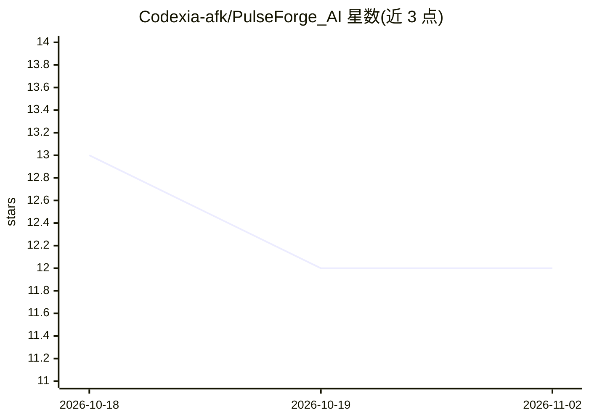

# Codexia-afk/PulseForge_AI

⭐ 12 · TypeScript · MIT · 推送 2026-07-11 · [GitHub](https://github.com/Codexia-afk/PulseForge_AI) · [官网](https://pulse-forge-ai-liart.vercel.app) · 组织维护

**AI 商业智能平台：从公开商业信号生成企业数字孪生与战略建议**

面向创业者、企业、顾问与商务拓展团队的战略商业智能平台。通过 agentic AI 工作流持续采集并分析招聘、产品发布、融资公告等公开商业信号，为组织构建 AI Business Twin，提供合作匹配引擎、场景模拟、证据溯源与管理层决策支持。技术栈为 React/TypeScript 前端加 FastAPI 后端，AI 与数据依赖 Google Gemini、Tavily、NewsAPI 等外部 API，需配置多个 API key。为黑客松项目，集成 Salesforce/Slack 等列入未来计划。

## 筛选速览

| 维度 | 判定 | 备注 |
|---|---|---|
| AI 角色 | `ai-native` | 本体是模型或模型工具 |
| 许可风险 | `permissive` | MIT |
| 部署形态 | `library` | 以包/库形式分发 |
| 模型依赖 | — | README 未给出锁定关系 |
| 硬件要求 | — | 无带数字的原话,不猜 |
| 安装摩擦 | `low` | 无编译、无系统依赖或容器化 |
| 成熟度 | — | 结构信号不足 |

## 能力要点

- 从公开商业信号生成组织的 AI Business Twin
- 合作匹配引擎与场景模拟器
- 基于证据的可解释性与证据浏览器
- 战略生态可视化与决策支持仪表盘

## 适用场景

- 发现潜在战略合作机会
- 跟踪目标公司的公开商业信号做市场情报
- 为管理层决策提供有证据支撑的建议

## 场景标签

`数据分析` · 领域:效率与自动化

## 证据(README 行号)

> L5: PulseForge AI transforms real-time public business signals into actionable strategic intelligence by building dynami
> L13: PulseForge AI continuously discovers, analyzes, validates, and explains these signals through an agentic AI workflo

## 星数曲线

2026-10-18 13 → 2026-11-02 12（-1）

---
*卡片 v1 · prompt 1.4 · 生成 2026-11-01 · 置信度 high · 依据 README sha `79bf33ab262b` · [字段定义](../../DATASET.md)*
