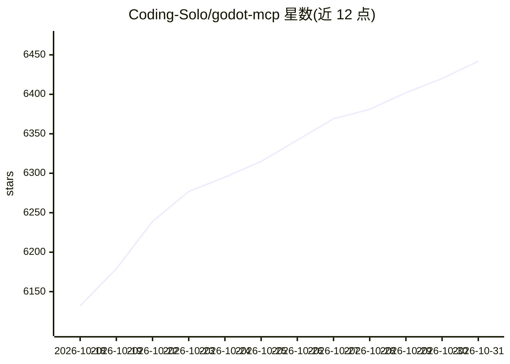

# Coding-Solo/godot-mcp

⭐ 6,442 · JavaScript · MIT · 推送 2026-04-16 · [GitHub](https://github.com/Coding-Solo/godot-mcp) · 个人维护

**让 AI agent 操作 Godot 引擎的 MCP 服务器**

面向支持 MCP 协议的 AI 客户端（Claude Code、Cline、Cursor 等）的 MCP 服务器：提供启动 Godot 编辑器、调试模式运行项目、捕获调试输出、启动/停止项目、场景创建与节点添加、UID 管理（Godot 4.4+）等工具。架构上简单操作直接调用 Godot CLI，复杂操作通过打包的 GDScript（godot_operations.gd）以 JSON 参数执行，无需生成临时文件。要求系统已安装 Godot 引擎与 Node.js（>=18），经 npx 或源码构建安装。

## 筛选速览

| 维度 | 判定 | 备注 |
|---|---|---|
| AI 角色 | `ai-ecosystem` | LLM/agent 周边工具 |
| 许可风险 | `permissive` | MIT |
| 部署形态 | `library` | 以包/库形式分发 |
| 模型依赖 | locked-api |  |
| 硬件要求 | — | 无带数字的原话,不猜 |
| 安装摩擦 | `low` | 无编译、无系统依赖或容器化 |
| 成熟度 | — | 结构信号不足 |

## 能力要点

- 启动编辑器、调试运行、启停项目与捕获调试输出
- 场景创建、节点添加、Sprite 加载、MeshLibrary 导出等场景管理
- 简单操作走 Godot CLI，复杂操作经打包 GDScript 以 JSON 参数执行
- 支持 GODOT_PATH 与 DEBUG 环境变量，可覆盖 Godot 可执行文件自动检测

## 适用场景

- 在 Claude Code/Cline/Cursor 中让 AI agent 直接运行和调试 Godot 项目
- 让 AI 通过实时调试输出修正生成的 GDScript 代码
- 用 AI 程序化管理 Godot 场景与节点结构

## 场景标签

 · 领域:游戏开发/AI 工具集成

## 证据(README 行号)

> L14: A Model Context Protocol (MCP) server for interacting with the Godot game engine.
> L18: Godot MCP enables AI agents to launch the Godot editor, run projects, capture debug output, and control project exe

## 星数曲线

2026-10-18 6,132 → 2026-10-31 6,442（+310）

---
*卡片 v1 · prompt 1.4 · 生成 2026-10-20 · 置信度 high · 依据 README sha `9abd9c54a8b0` · [字段定义](../../DATASET.md)*
