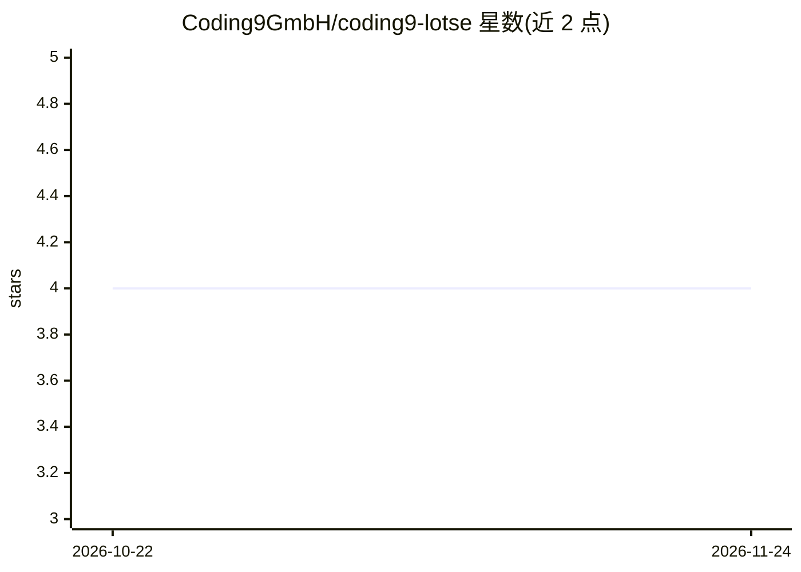

# Coding9GmbH/coding9-lotse

⭐ 4 · TypeScript · MIT · 推送 2026-11-09 · [GitHub](https://github.com/Coding9GmbH/coding9-lotse) · [官网](https://coding9.de/produkte/lotse) · 组织维护

**通过聊天管理电商店铺内容与价格的 AI 界面**

面向 Shopware 6、Shopify、Magento 2/OpenMage 店铺的聊天式管理界面：以自然语言下达任务，AI 只读访问店铺，生成价格调整、文本、SEO 与落地页草稿，经用户确认（Alt→Neu 对比）后才由服务端写入，附带审计日志与撤销。支持 Docker 部署与源码运行，连接方式为 Anthropic API 密钥或 ChatGPT 订阅（Codex）登录，含月度预算限制与按区域的 KI 访问授权。

## 筛选速览

| 维度 | 判定 | 备注 |
|---|---|---|
| AI 角色 | `ai-native` | 本体是模型或模型工具 |
| 许可风险 | `permissive` | MIT |
| 部署形态 | `self-host` | docker 或自建部署 |
| 模型依赖 | locked-api |  |
| 硬件要求 | — | 无带数字的原话,不猜 |
| 安装摩擦 | `low` | 无编译、无系统依赖或容器化 |
| 成熟度 | — | 结构信号不足 |

## 能力要点

- AI 仅持只读客户端，写入须用户逐次批准并记录审计日志
- 批量修改价格/库存/文本/SEO，服务端价格规则与撤销支持
- 支持 Anthropic API 或 ChatGPT 订阅（Codex）两种模型接入
- SEO 区域读取 Search Console 与 Sistrix 并给出优化任务

## 适用场景

- 通过对话批量调整店铺商品价格与文案
- 生成并审核 SEO 优化与落地页草稿
- 团队自托管部署管理多平台电商店铺

## 场景标签

`AI 写作` `聊天机器人` · 领域:对话与助手

## 证据(README 行号)

> L5:  Der KI-Lotse für deinen Onlineshop – Shopware 6, Shopify, Magento 2 und OpenMage. Du gibst den Kurs vor – Lotse bri
> L118: ## Konzept: AI-first Verwaltung
> L121: **Sicherheitsmodell:** Die KI hat ausschließlich Lesezugriff (`ReadOnlyShopware`, kein create/update/upload). Schr

## 星数曲线

2026-10-22 4 → 2026-11-24 4（+0）

---
*卡片 v1 · prompt 1.4 · 生成 2026-11-22 · 置信度 high · 依据 README sha `88108eb23d12` · [字段定义](../../DATASET.md)*
