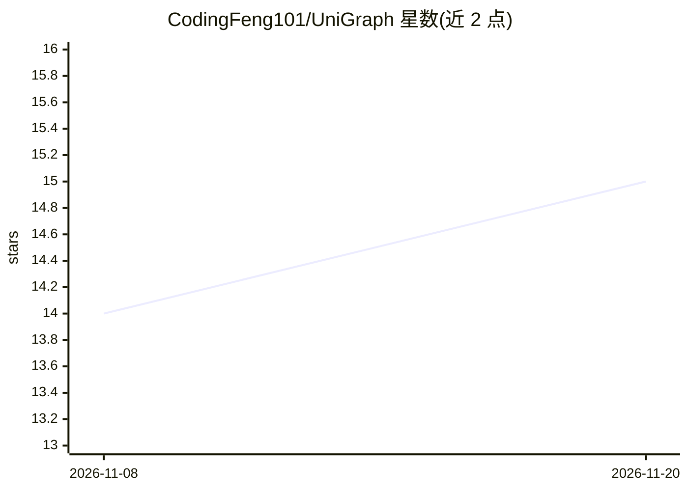

# CodingFeng101/UniGraph

⭐ 15 · Python · AGPL-3.0 · 推送 2026-11-01 · [GitHub](https://github.com/CodingFeng101/UniGraph) · [官网](https://unigraph.codingfgd.asia) · 组织维护 · 中文 README

**面向企业的知识图谱构建与可追溯 GraphRAG 问答平台**

以工作台形式覆盖知识图谱全流程：先从领域资料生成并人工编辑 Schema，再从 PDF/DOCX/TXT/JSON 抽取实体与关系并可视化检查，最后以社区报告与向量索引支撑带四类引用（实体、关系、原文、社区）的多轮问答。采用 Vue 3 + FastAPI + MySQL/Redis/Celery 架构，LLM 通过 OpenAI 兼容接口接入，API Key 后端加密保存。提供 Docker Compose 与传统进程两种部署方式，当前处于 Beta 阶段，项目不建议直接用于关键生产环境。

## 筛选速览

| 维度 | 判定 | 备注 |
|---|---|---|
| AI 角色 | `ai-native` | 本体是模型或模型工具 |
| 许可风险 | `viral` | AGPL-3.0 |
| 部署形态 | `self-host` | docker 或自建部署 |
| 模型依赖 | — | README 未给出锁定关系 |
| 硬件要求 | — | 无带数字的原话,不猜 |
| 安装摩擦 | `low` | 无编译、无系统依赖或容器化 |
| 成熟度 | `idea` | |

## 能力要点

- 设计-构建-应用三工作区流程，抽取前人工审查 Schema（human-in-the-loop）
- 应用结果支持实体、关系、原文、社区四类引用回溯
- 读取 PDF/DOCX/TXT/JSON 等文档进行实体关系抽取
- 提供 Docker Compose 与传统 Python/Node 两种部署路径

## 适用场景

- 把企业领域文档库构建成可编辑的知识图谱
- 需要每个回答能追到原文出处的知识问答
- 定义领域 Schema 后批量抽取实体与关系
- 在向量检索之外增加结构化知识层的知识库建设

## 场景标签

`知识图谱` `RAG` `文档解析` · 领域:知识与检索

## 证据(README 行号)

> L25: UniGraph 提供三个核心能力：
> L116: UniGraph 会将局部实体与关系、原始信息源和全局社区概览组织成统一上下文。应用结果中的引用可以继续展开，帮助用户判断结论来自哪里，而不是只接受一个无法验证的模型答案。
> L135: |AI 接入|OpenAI 兼容语言模型与嵌入模型|

## 星数曲线

2026-11-08 14 → 2026-11-20 15（+1）

---
*卡片 v1 · prompt 1.4 · 生成 2026-11-18 · 置信度 high · 依据 README sha `f10ce45908d1` · [字段定义](../../DATASET.md)*
