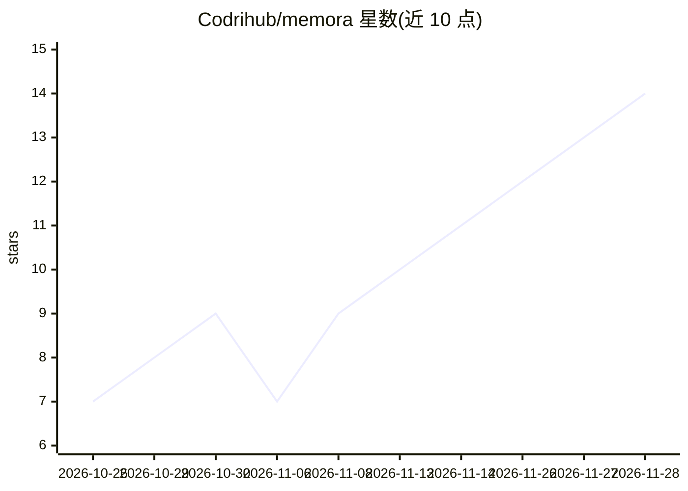

# Codrihub/memora

⭐ 14 · TypeScript · AGPL-3.0 · 推送 2026-11-27 · [GitHub](https://github.com/Codrihub/memora) · [官网](https://memora.codrihub.tech) · 组织维护

**给 AI agent 的自托管长期记忆库，经 MCP 读写 markdown 笔记**

Memora 是自托管的 agent 记忆库：笔记为 git 管理的纯 markdown 文件，agent 通过 MCP（streamable HTTP，77 个工具）读写，用户在 Web UI 中浏览、编辑和治理。单个 Rust 二进制在同一端口提供 HTTP API、MCP 端点、Web UI 与实时更新，状态存于内嵌 SQLite。支持每个 agent 独立 API key/OAuth、按 key 的工具范围与隐私规则、历史 diff 与回滚；内置笔记 agent Mnemo 使用用户自己的 OpenAI/Anthropic/OpenAI 兼容 key，无 web、shell 或彻底删除权限。

## 筛选速览

| 维度 | 判定 | 备注 |
|---|---|---|
| AI 角色 | `ai-ecosystem` | LLM/agent 周边工具 |
| 许可风险 | `viral` | AGPL-3.0 |
| 部署形态 | `self-host` | docker 或自建部署 |
| 模型依赖 | — | README 未给出锁定关系 |
| 硬件要求 | — | 无带数字的原话,不猜 |
| 安装摩擦 | `low` | 无编译、无系统依赖或容器化 |
| 成熟度 | — | 结构信号不足 |

## 能力要点

- 77 个 MCP 工具覆盖笔记、搜索、标签、图遍历与历史
- markdown + git 历史，可列出、diff、恢复任意版本
- 每 agent 独立 API key、scope 与隐私规则治理
- Mnemo 内置笔记 agent，使用用户自备的 API key

## 适用场景

- 为自己的 AI agent 配置长期记忆库
- 团队在 Web UI 中审阅和管理 agent 写入的笔记
- 需要审计 agent 对记忆的每次读写活动

## 场景标签

`Agent 记忆` `知识图谱` · 领域:Agent 开发

## 证据(README 行号)

> L21: Memora is a self-hosted memory vault for AI agents. Notes are plain markdown
> L22: files in a git-backed folder. Agents read and write them over the Model Context
> L46: - **MCP for agents.** 77 tools for notes, folders, search, tags, graph traversal,

## 星数曲线

2026-10-26 7 → 2026-11-28 14（+7）

---
*卡片 v1 · prompt 1.4 · 生成 2026-11-19 · 置信度 high · 依据 README sha `9e9a937550e2` · [字段定义](../../DATASET.md)*
