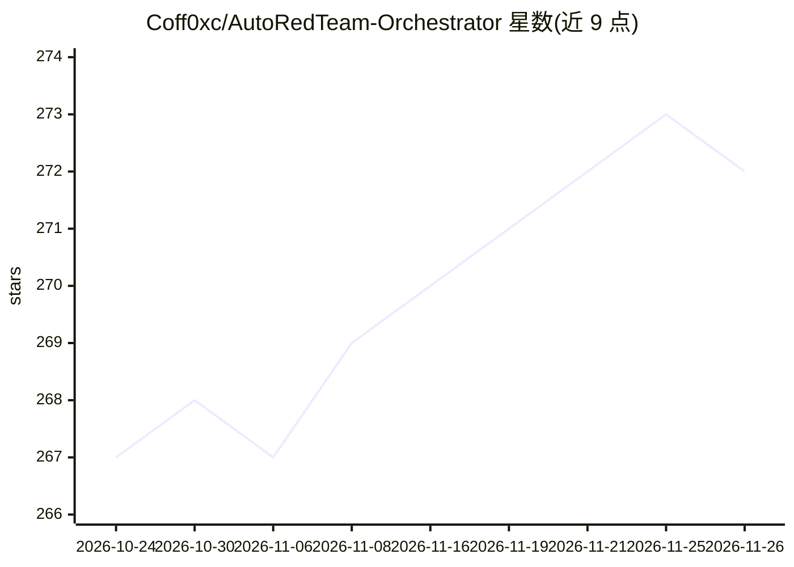

# Coff0xc/AutoRedTeam-Orchestrator

⭐ 272 · Python · NOASSERTION · 推送 2026-11-25 · [GitHub](https://github.com/Coff0xc/AutoRedTeam-Orchestrator) · [官网](https://github.com/Coff0xc/AutoRedTeam-Orchestrator/releases/tag/v4.1.0) · 个人维护

**给安全人员做本地 MCP/AI 攻击面审计与授权测试取证的工具**

面向 MCP/AI 环境的安全审计与授权测试编排器：默认模式读取本地代码、AI 客户端配置或指令文件，输出带文件与行号的发现报告（SARIF），并内置 OWASP MCP Top 10 离线映射；另一模式按 plan→recon→detect→verify→export 流程执行授权测试，发现项需经外部验证并留存请求/响应回执方可确认。核心机制是四级权限清单（safe/scan/active-lab/full）、API key 认证、HITL 门控与向模型展示约束卡片。安装包不含实验引擎；沙箱设置仅是记录备注，非容器或系统边界。

## 筛选速览

| 维度 | 判定 | 备注 |
|---|---|---|
| AI 角色 | `ai-ecosystem` | LLM/agent 周边工具 |
| 许可风险 | `none` | NOASSERTION |
| 部署形态 | `self-host` | docker 或自建部署 |
| 模型依赖 | — | README 未给出锁定关系 |
| 硬件要求 | — | 无带数字的原话,不猜 |
| 安装摩擦 | `low` | 无编译、无系统依赖或容器化 |
| 成熟度 | `idea` | |

## 能力要点

- 四级权限清单（153 条目）按级别逐步解锁工具，注册前统一校验
- 发现项需经 vuln_verifier/oob_callback 等外部验证并留存回执才标记确认
- 服务器启动时用约束卡片替换工具描述与函数注释
- 本地解析 Python 文件结构，不导入、不调用工具

## 适用场景

- 审计自己项目的 MCP/AI 攻击面并输出 SARIF 报告
- 在授权环境下按步骤执行侦察、检测与验证流程
- 在 CI 中用 --ci 与确认率门控拦截未通过的运行

## 场景标签

`网络安全` · 领域:学习与行业

## 证据(README 行号)

> L3: Two loops, one allowlist. The default is a local MCP/AI attack-surface audit: you point it at your own code, your AI
> L58: |Editor server|`autoredteam-mcp --stdio`|Start at `safe`|
> L118: MCP tools: `engage_init`, `engage_status`, `engage_next` (safe), `engage_run` (scan). A model that only has `safe`

## 星数曲线

2026-10-24 267 → 2026-11-26 272（+5）

---
*卡片 v1 · prompt 1.4 · 生成 2026-11-26 · 置信度 mid · 依据 README sha `3e81fd31f495` · [字段定义](../../DATASET.md)*
