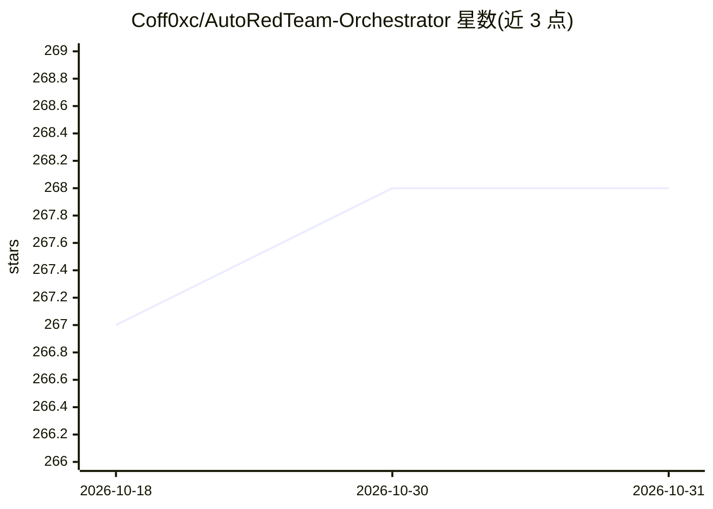

# Coff0xc/AutoRedTeam-Orchestrator

⭐ 268 · Python · NOASSERTION · 推送 2026-09-17 · [GitHub](https://github.com/Coff0xc/AutoRedTeam-Orchestrator) · 个人维护 · 中文 README

**面向授权测试与 AI/MCP 攻击面自审的 MCP-native 安全自动化工作台**

单一代码库提供安全能力（侦察、漏洞检测、CVE 情报、编排、受限的后渗透/C2），通过 MCP Server、Python SDK 与 Typer CLI 三个入口暴露，供 AI 编辑器/Agent 经 MCP 调用受控安全能力。产品线之一是对自身仓库做 AI/MCP 攻击面的纯静态审计（只读 AST→SARIF，接入 GitHub Code Scanning），无需网络与授权。采用四级能力档案（safe/scan/active-lab/full）fail-closed 注册，高风险能力默认 dry-run，仅限一次性隔离靶场。自声明 Beta/Research Preview。

## 筛选速览

| 维度 | 判定 | 备注 |
|---|---|---|
| AI 角色 | `ai-ecosystem` | LLM/agent 周边工具 |
| 许可风险 | `none` | NOASSERTION |
| 部署形态 | `library` | 以包/库形式分发 |
| 模型依赖 | — | README 未给出锁定关系 |
| 硬件要求 | — | 无带数字的原话,不猜 |
| 安装摩擦 | `low` | 无编译、无系统依赖或容器化 |
| 成熟度 | `idea` | |

## 能力要点

- MCP Server + Python SDK + Typer CLI 三入口共享同一 core/ 引擎
- AI/MCP 攻击面静态自审：handler、.mcp.json 配置、skill 文件 → SARIF
- 四级能力档案 fail-closed 注册，默认最窄 safe 档案，高风险能力默认 dry-run
- 可作为 GitHub Action 在 PR 上运行 self-audit

## 适用场景

- 通过 Claude Code/Cursor 等 MCP 客户端调用受控安全能力
- 对自己仓库的 MCP handler 与 skill 文件做静态攻击面审计并接入 Code Scanning
- 授权靶场中跑侦察、漏洞检测与一键渗透编排流水线

## 场景标签

`网络安全` · 领域:学习与行业

## 证据(README 行号)

> L20: AutoRedTeam-Orchestrator 在单一代码库中提供可组合的安全能力，并通过三个入口暴露：**MCP Server**、**Python SDK** 与 **Typer CLI**。产品主线是 **AI 辅助的安全
> L29: |AI/MCP 攻击面静态自审|Preview|只读 AST → SARIF；覆盖 FastMCP 与 low-level SDK|
> L71: MCP Server 把安全能力暴露为 MCP 工具，供 AI 编辑器或 Agent 调用。它是 local-first 的：无云端、无遥测，仅限受信本地 stdio。

## 星数曲线

2026-10-18 267 → 2026-10-31 268（+1）

---
*卡片 v1 · prompt 1.4 · 生成 2026-10-22 · 置信度 high · 依据 README sha `500cc1d254fc` · [字段定义](../../DATASET.md)*
