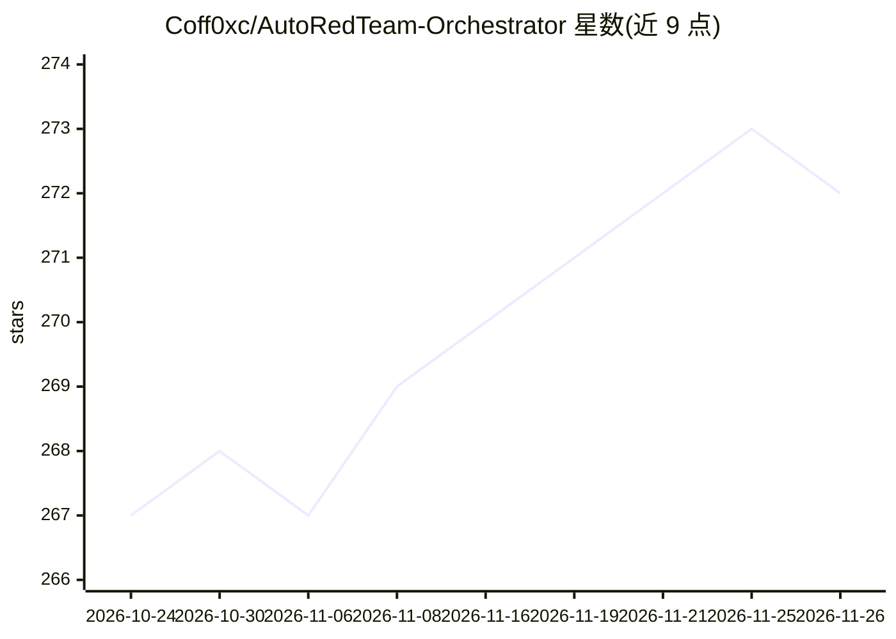

# Coff0xc/AutoRedTeam-Orchestrator

⭐ 272 · Python · NOASSERTION · 推送 2026-11-25 · [GitHub](https://github.com/Coff0xc/AutoRedTeam-Orchestrator) · [官网](https://github.com/Coff0xc/AutoRedTeam-Orchestrator/releases/tag/v4.1.0) · 个人维护

**本地 MCP/AI 攻击面审计工具：读自身代码并输出带行号证据的发现**

面向授权测试的 Python 工具，默认回路是本地 MCP/AI 攻击面审计：解析自身 Python 代码、AI 客户端配置与指令文件，输出带文件与行号的发现，可导出 SARIF 并做 CI diff。另一回路是授权渗透流程 plan→recon→detect→verify→export，通过 YAML 会话文件让人与模型共享步骤，发现需经外部核验（vuln_verifier/oob_callback 等）才确认。核心机制是四级权限 allowlist（safe/scan/active-lab/full，153 条目）、模型只读工具卡片、HITL 门与 API key 认证；pip/容器安装不含实验性引擎。

## 筛选速览

| 维度 | 判定 | 备注 |
|---|---|---|
| AI 角色 | `ai-enhanced` | 去掉 AI 部分产品仍成立 |
| 许可风险 | `none` | NOASSERTION |
| 部署形态 | `self-host` | docker 或自建部署 |
| 模型依赖 | — | README 未给出锁定关系 |
| 硬件要求 | — | 无带数字的原话,不猜 |
| 安装摩擦 | `low` | 无编译、无系统依赖或容器化 |
| 成熟度 | `idea` | |

## 能力要点

- 四级权限 allowlist（safe 30/scan 96/active-lab 117/full 153 条目）控制模型可用工具
- 发现需经 vuln_verifier、oob_callback 或 manual_review 外部核验才确认，输出 scorecard
- 模型不读代码内注释，只读启动时生成的短卡片（名称/级别/风险/效果/限制）
- 文件读取器解析 Python 但不导入、不调用工具；CLI/MCP/Python 三种入口

## 适用场景

- 扫描自己项目的 MCP/AI 攻击面并导出 SARIF 做基线对比
- 在授权测试中让模型与操作者共享同一 engage 会话文件协作
- 在 CI 中用 --dry-run --ci 对发现循环做门禁

## 场景标签

`网络安全` · 领域:学习与行业

## 证据(README 行号)

> L3: Two loops, one allowlist. The default is a local MCP/AI attack-surface audit: you point it at your own code, your AI
> L5: The other loop is an authorized engagement. You write one target file. Humans and models share the same steps: plan,
> L7: The model can decide. This program keeps the permission, the evidence, and the record.

## 星数曲线

2026-10-24 267 → 2026-11-26 272（+5）

---
*卡片 v1 · prompt 1.4 · 生成 2026-11-25 · 置信度 high · 依据 README sha `1bd22e145a0f` · [字段定义](../../DATASET.md)*
