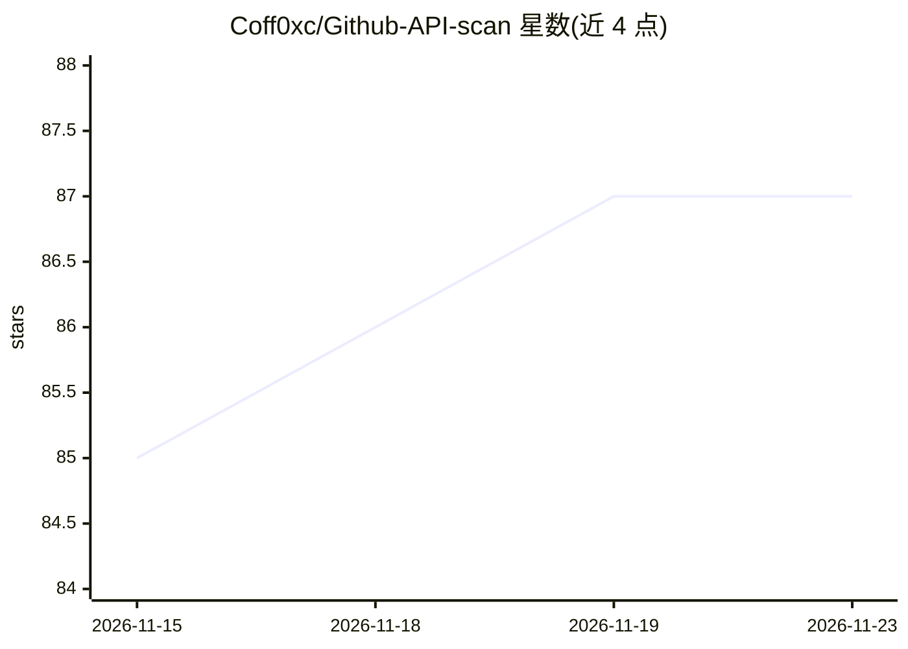

# Coff0xc/Github-API-scan

⭐ 87 · Python · MIT · 推送 2026-11-16 · [GitHub](https://github.com/Coff0xc/Github-API-scan) · 个人维护 · 中文 README

**扫描 GitHub 组织/仓库或本地 git，检测泄露的 AI API 密钥**

面向安全审计的 Python 命令行工具：针对单个组织、仓库或本地目录（含 git 历史）扫描泄露的 AI API 密钥，支持 OpenAI、Claude、Gemini、xAI、DeepSeek 等约 50 种平台。每条发现绑定为 (key, base_url) 对，向对应地址验证密钥是否仍有效，原始密钥仅留在本地 SQLite 数据库（可用口令加密）。提供 Web 仪表盘展示掩码后的发现，支持处置状态流转（open/notified/rotated/false_positive）。扫描前需 --authorized 确认授权，内置 SSRF 防护与 Discord/Slack 通知。可选 AI 辅助过滤示例性行，默认关闭。

## 筛选速览

| 维度 | 判定 | 备注 |
|---|---|---|
| AI 角色 | `ai-enhanced` | 去掉 AI 部分产品仍成立 |
| 许可风险 | `permissive` | MIT |
| 部署形态 | `self-host` | docker 或自建部署 |
| 模型依赖 | — | README 未给出锁定关系 |
| 硬件要求 | — | 无带数字的原话,不猜 |
| 安装摩擦 | `low` | 无编译、无系统依赖或容器化 |
| 成熟度 | — | 结构信号不足 |

## 能力要点

- 绑定密钥与其 relay base_url 并验证有效性，四种状态判定
- 本地 git 历史扫描：读取唯一 blob，跳过已记录对象
- SSRF 防护：拒绝私网/链路本地/保留地址，回环仅限本地 relay
- SHA-256 指纹标识发现，完整密钥不出本机，数据库 Fernet 加密

## 适用场景

- 审计本组织仓库中泄露的 AI API 密钥并跟踪轮换处置
- 清理本地项目 git 历史中的残留密钥
- 在授权的漏洞赏金/渗透测试中定位有效密钥

## 场景标签

`网络安全` · 领域:学习与行业

## 证据(README 行号)

> L3: Scan one organization, one repository, or a local git tree.
> L215: Set `AI_FILTER_ENABLED=1` if you want a model to drop rows that look like examples. It is off unless you turn it o

## 星数曲线

2026-11-15 85 → 2026-11-23 87（+2）

---
*卡片 v1 · prompt 1.4 · 生成 2026-11-18 · 置信度 mid · 依据 README sha `3a4591bf0886` · [字段定义](../../DATASET.md)*
