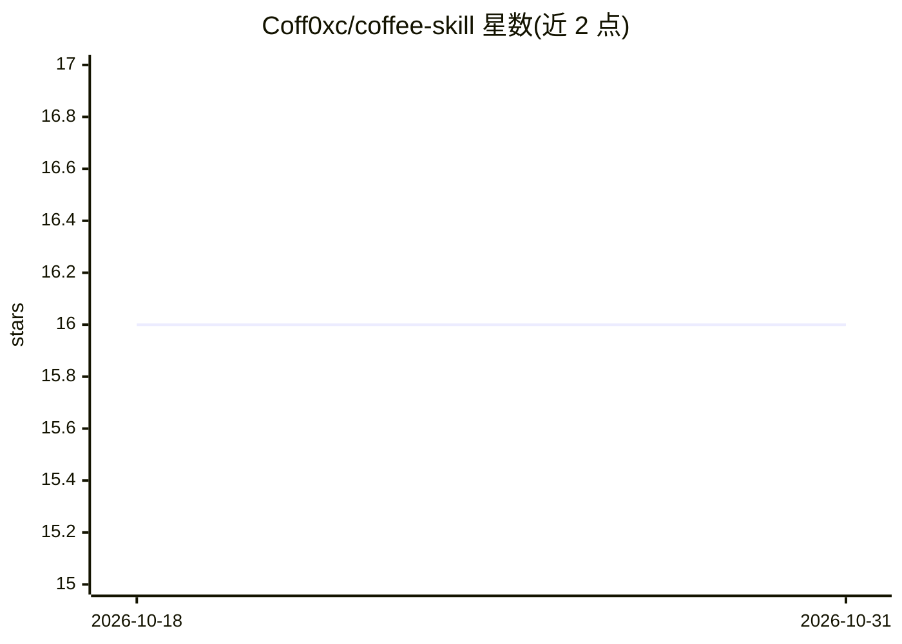

# Coff0xc/coffee-skill

⭐ 16 · Python · NOASSERTION · 推送 2026-05-22 · [GitHub](https://github.com/Coff0xc/coffee-skill) · 个人维护 · 中文 README

**面向 Codex/AgentSkills 客户端的可安装工作流 skill 包**

以 SKILL.md 格式组织的 skill pack，含 18 个发布 skill，覆盖软件工程、UI、Office 文档（PPTX/XLSX/DOCX 解包检查）、Agent/RAG、API/数据契约、draw.io 科研图与授权安全审计等领域；跨域任务由 coff0xc-skill-router 选主 skill、排阶段并支持执行中重路由。质量证据通过 trigger eval（131 个 proxy cases）、quality eval 与 golden responses 在 release/CI 阶段验证。采用 PowerShell 脚本本地安装；仓库公开可见但为自定义 source-available noncommercial 授权，商用需书面许可。

## 筛选速览

| 维度 | 判定 | 备注 |
|---|---|---|
| AI 角色 | `ai-ecosystem` | LLM/agent 周边工具 |
| 许可风险 | `none` | NOASSERTION |
| 部署形态 | `None` |  |
| 模型依赖 | — | README 未给出锁定关系 |
| 硬件要求 | — | 无带数字的原话,不猜 |
| 安装摩擦 | `low` | 无编译、无系统依赖或容器化 |
| 成熟度 | — | 结构信号不足 |

## 能力要点

- 18 个发布 skill 覆盖 dev/UI/Office/Agent-RAG/API-安全等领域
- router 对跨域任务做主 skill 选择、阶段编排与执行中重路由
- trigger eval 覆盖 131 个本地 proxy cases，CI 自动运行验证门禁
- Office skill 解包 OOXML 检查 PPTX/XLSX/DOCX 结构、公式与渲染证据

## 适用场景

- 让 Codex/AgentSkills 客户端按任务直达对应 skill 完成编码、UI 或 Office 交付
- 跨前后端/数据/安全的复合任务由 router 自动编排 skill 工作流
- 以证据（diff、截图、OOXML 解包、验证输出）约束 agent 交付质量

## 场景标签

`提示工程` `网络安全` `代码审查` · 领域:Agent 开发

## 证据(README 行号)

> L12: `coffee-skill` 是给 Codex / AgentSkills 兼容客户端安装的工作流 skill pack。它解决的是 AI vibe coding 的三个高频问题：AI 不知道该用什么能力、做出来的东西没质量证据、
> L244: `coffee-skill` is an installable `SKILL.md` workflow pack. It is built for the three failure modes that hurt agent

## 星数曲线

2026-10-18 16 → 2026-10-31 16（+0）

---
*卡片 v1 · prompt 1.4 · 生成 2026-10-30 · 置信度 high · 依据 README sha `e2d2f981d17b` · [字段定义](../../DATASET.md)*
