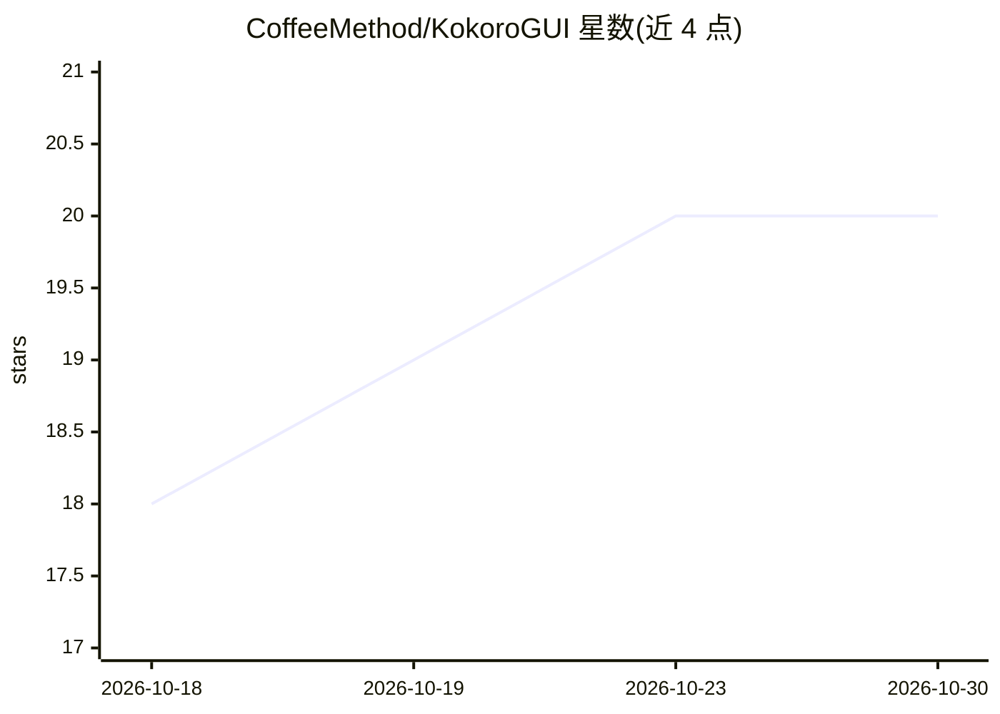

# CoffeeMethod/KokoroGUI

⭐ 20 · Python · Apache-2.0 · 推送 2026-10-24 · [GitHub](https://github.com/CoffeeMethod/KokoroGUI) · [官网](https://coffeemethod.github.io/KokoroGUI/) · 个人维护

**本地 TTS 音频制作 GUI：文本驱动多角色配音与时间线混音**

桌面端文本式音频工作流应用：导入或输入文稿（txt/pdf/epub/字幕），按行分配角色，用本地 Kokoro 引擎（8 语言命名音色）或 Audio8 声音克隆生成语音，片段落到带混音器与自动化控制的时间线上；改词仅重新生成对应片段。内置 Pedalboard 非破坏音效链、配音对位、录音转写编辑与音乐垫底，导出 wav/mp3/flac/ogg 及字幕。需 Python 3.11+ 与 eSpeak NG，模型首次从 Hugging Face 下载，Whisper 约 1.6GB 可配置为更小模型。

## 筛选速览

| 维度 | 判定 | 备注 |
|---|---|---|
| AI 角色 | `ai-native` | 本体是模型或模型工具 |
| 许可风险 | `permissive` | Apache-2.0 |
| 部署形态 | `library` | 以包/库形式分发 |
| 模型依赖 | — | README 未给出锁定关系 |
| 硬件要求 | — | 无带数字的原话,不猜 |
| 安装摩擦 | `low` | 无编译、无系统依赖或容器化 |
| 成熟度 | `idea` | |

## 能力要点

- Kokoro 与 Audio8 声音克隆双引擎，每角色独立选择
- 改文本仅重新生成变更片段的增量生成机制
- 时间线与混音器（fader/pan/自动化/淡入淡出），Pedalboard 非破坏音效链
- 支持 epub/pdf/字幕导入与配音对位，导出含 .srt 与 cue sheet

## 适用场景

- 把 epub 或文稿做成多角色有声书
- 播客/视频配音制作，按角色混音后导出
- 基于字幕做配音对位与译制
- 编辑自己的录音：改转写文本即改音频

## 场景标签

`语音合成` `语音识别` · 领域:内容生成

## 证据(README 行号)

> L9: and only that clip generates again. It runs locally on Kokoro,
> L25: - **Two engines.** Kokoro's named and mixable voices in 8 languages, and Audio8, which clones a
> L58: Models download from Hugging Face the first time you use them. Whisper, the transcriber, is about

## 星数曲线

2026-10-18 18 → 2026-10-30 20（+2）

---
*卡片 v1 · prompt 1.4 · 生成 2026-10-28 · 置信度 mid · 依据 README sha `2acfd2de7178` · [字段定义](../../DATASET.md)*
