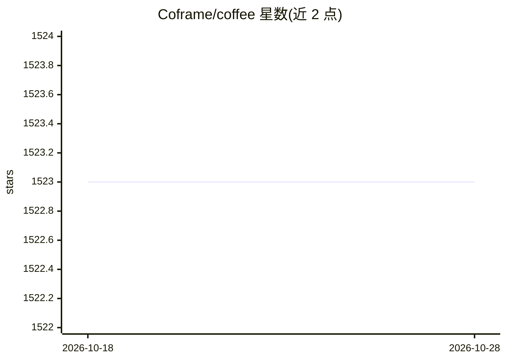

# Coframe/coffee

⭐ 1,523 · Python · Apache-2.0 · 推送 2026-06-28 · [GitHub](https://github.com/Coframe/coffee) · [官网](https://twitter.com/coframe_ai) · 组织维护

**在 IDE 内用 AI 生成与迭代 React UI 组件的 Docker 工具**

Coframe 开源的 AI 前端生成工具：通过 Docker 容器监听 React 项目中 js/jsx/ts/tsx 文件变化，检测 `<Coffee>` JSX 组件或 `coffee` 属性后，将父组件代码与提示词传给 OpenAI API 生成或修改组件代码；满意后用 `pour` 属性把生成代码写回源文件。适配任意 React 代码库（Next.js、Remix 等），无需额外依赖安装。当前生成速度较慢，Vue/Svelte 等框架支持在 TODO 中。

## 筛选速览

| 维度 | 判定 | 备注 |
|---|---|---|
| AI 角色 | `ai-native` | 本体是模型或模型工具 |
| 许可风险 | `permissive` | Apache-2.0 |
| 部署形态 | `self-host` | docker 或自建部署 |
| 模型依赖 | — | README 未给出锁定关系 |
| 硬件要求 | — | 无带数字的原话,不猜 |
| 安装摩擦 | `low` | 无编译、无系统依赖或容器化 |
| 成熟度 | `idea` | |

## 能力要点

- 监听文件保存，识别 <Coffee> 组件触发 AI 生成
- 通过 pour 属性将生成代码写回源文件形成可复用组件
- 支持编辑已有组件（coffee 属性描述变更）
- Docker 隔离运行生成的 agent 代码

## 适用场景

- 在现有 React 项目中用自然语言提示生成新组件
- 通过属性描述迭代修改已有组件
- 在任意 IDE 中获得 AI 辅助的 UI 开发流程

## 场景标签

`代码生成` · 领域:编码与开发

## 证据(README 行号)

> L5: _Build and iterate on your UI 10x faster with AI - right from your own IDE!_
> L57: Every time you save your source file, Coffee will look to see if there are any `<Coffee>` components which need bre
> L73: Finally, once you're happy with your brewed component, you can add a `pour="ComponentName.tsx"` prop to your `<Coff

## 星数曲线

2026-10-18 1,523 → 2026-10-28 1,523（+0）

---
*卡片 v1 · prompt 1.4 · 生成 2026-10-21 · 置信度 mid · 依据 README sha `be25af5f48d0` · [字段定义](../../DATASET.md)*
