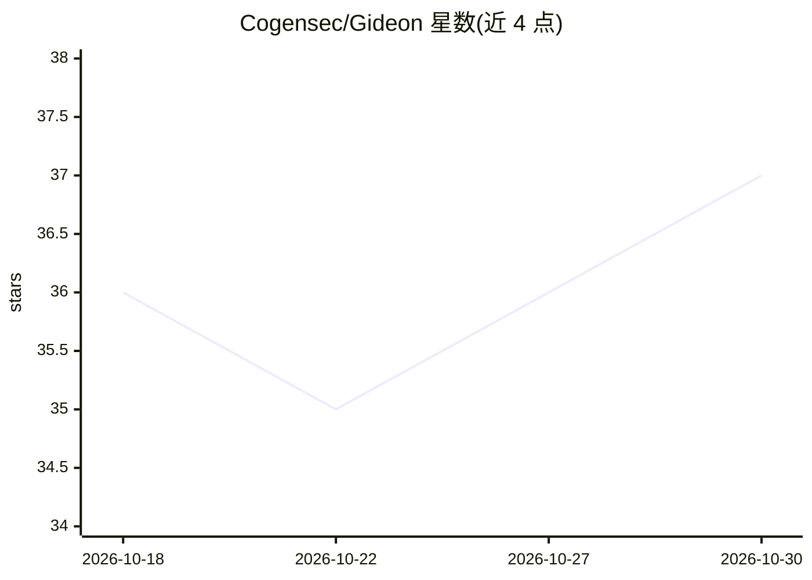

# Cogensec/Gideon

⭐ 37 · TypeScript · 推送 2026-06-25 · [GitHub](https://github.com/Cogensec/Gideon) · [官网](http://gideon.cogensec.com) · 组织维护

**自主安全运营与红队 agent：威胁调查、漏洞分析与 IOC 评估**

以 TypeScript/Bun 构建的自主安全运营 agent，采用 ReAct 循环（计划-行动-观察-反思）执行威胁情报研究：CVE 深度分析（NVD/CISA KEV）、IOC 信誉核查（VirusTotal/AbuseIPDB）、语义搜索（Exa AI）、每日威胁简报与 AWS/Azure/GCP/K8s/Okta 加固清单生成。默认防御模式，经授权可切换红队模式（Nmap/Metasploit 等工具在 Docker 沙箱内、按 EngagementScope 硬性限制执行）。LLM 接入支持 OpenRouter、OpenAI、Anthropic、Google 与本地 Ollama，可选集成 NVIDIA NIM/Morpheus/NeMo Guardrails。通过 git clone 源码安装，依赖 Bun v1.3.6+。

## 筛选速览

| 维度 | 判定 | 备注 |
|---|---|---|
| AI 角色 | `ai-native` | 本体是模型或模型工具 |
| 许可风险 | `none` | — |
| 部署形态 | `None` |  |
| 模型依赖 | local-ok | 支持本地模型 |
| 硬件要求 | — | 无带数字的原话,不猜 |
| 安装摩擦 | `low` | 无编译、无系统依赖或容器化 |
| 成熟度 | — | 结构信号不足 |

## 能力要点

- ReAct agent 循环驱动多步安全研究任务，输出证据支撑结论
- CVE 研究、IOC 信誉、神经搜索、每日简报、策略生成五类核心能力
- 双模式架构：默认防御，红队模式下进攻工具经范围校验并在 Docker 沙箱执行
- MCP 协议扩展工具集成，NeMo Guardrails 提供越狱检测与审计日志

## 适用场景

- 让 agent 自主调查某个 CVE 的可利用性与补丁状态
- 批量核查可疑 IP/域名/哈希的 IOC 信誉
- 授权红队行动中做侦察、横向移动与后渗透规划
- 生成云平台与 Kubernetes 的安全加固检查清单

## 场景标签

`网络安全` · 领域:学习与行业

## 证据(README 行号)

> L35: Gideon is not a script. It is not a scanner. It is an **autonomous security operations agent** that thinks, plans, 
> L174: Gideon implements a **ReAct (Reasoning + Acting)** agent loop — plan, act, observe, reflect, repeat — with a modul

## 星数曲线

2026-10-18 36 → 2026-10-30 37（+1）

---
*卡片 v1 · prompt 1.4 · 生成 2026-10-25 · 置信度 high · 依据 README sha `9ab6479265bb` · [字段定义](../../DATASET.md)*
