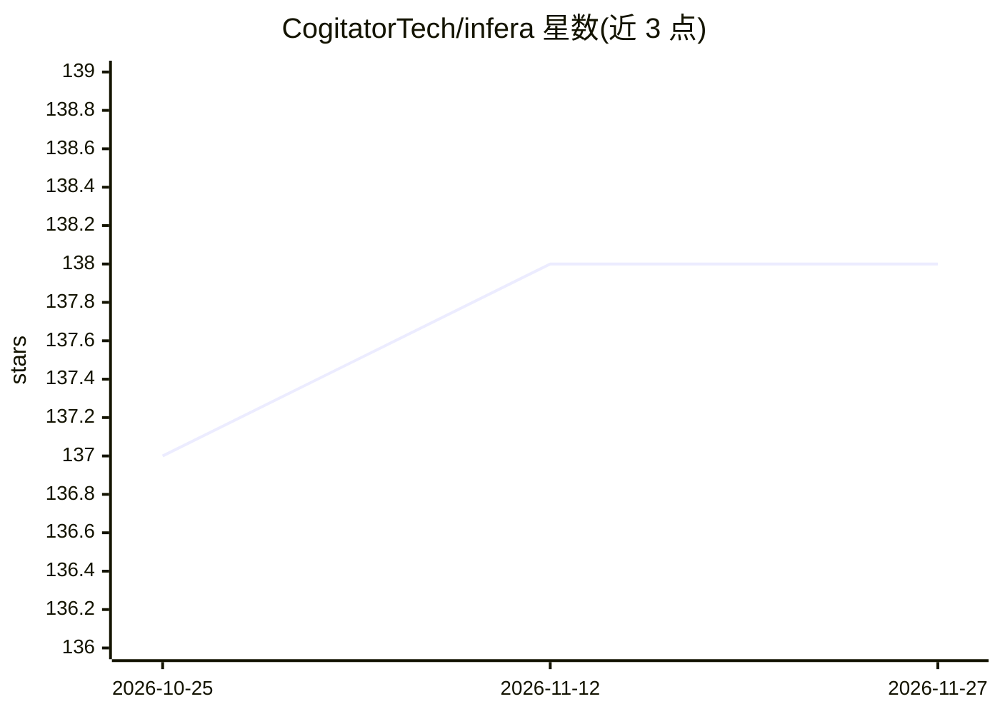

# CogitatorTech/infera

⭐ 138 · Rust · Apache-2.0 · 推送 2026-11-21 · [GitHub](https://github.com/CogitatorTech/infera) · 组织维护

**DuckDB 扩展：在 SQL 查询中直接运行 ML 模型推理**

Infera 是一个用 Rust 编写的 DuckDB 扩展，以 Tract 为后端推理引擎，支持在 SQL 查询中加载并运行 ONNX 格式的机器学习模型，对 DuckDB 表中数据执行推理，避免将数据导出到 Python/R 再导入结果的传统流程。支持本地与远程模型、表列或原始张量输入、单值与多值输出、指定目录自动加载模型，线程安全。项目处于早期开发阶段，预期存在 bug 与破坏性变更；扩展二进制仅与构建时对应的 DuckDB 版本兼容。

## 筛选速览

| 维度 | 判定 | 备注 |
|---|---|---|
| AI 角色 | `ai-native` | 本体是模型或模型工具 |
| 许可风险 | `permissive` | Apache-2.0 |
| 部署形态 | `None` |  |
| 模型依赖 | — | README 未给出锁定关系 |
| 硬件要求 | — | 无带数字的原话,不猜 |
| 安装摩擦 | `low` | 无编译、无系统依赖或容器化 |
| 成熟度 | `idea` | |

## 能力要点

- 在 SQL 查询中直接对 DuckDB 表数据执行 ML 推理
- 支持 ONNX 格式模型的本地与远程加载
- 支持表列或原始张量输入，单值与多值输出
- 可从指定目录自动加载全部模型

## 适用场景

- 在数据库内直接对表数据跑 ONNX 模型推理
- 省去导出数据到 Python/R 再导入结果的流程
- 从 Hugging Face 的 ONNX Model Zoo 选取现成模型做推理

## 场景标签

`推理引擎` · 领域:训练与推理

## 证据(README 行号)

> L12: Infera is a DuckDB extension that allows you to use machine learning (ML) models directly in SQL queries to perform
> L13: inference on data stored in DuckDB tables.
> L15: Infera supports loading and running models in ONNX format.

## 星数曲线

2026-10-25 137 → 2026-11-27 138（+1）

---
*卡片 v1 · prompt 1.4 · 生成 2026-11-27 · 置信度 high · 依据 README sha `b6e17f8c568a` · [字段定义](../../DATASET.md)*
