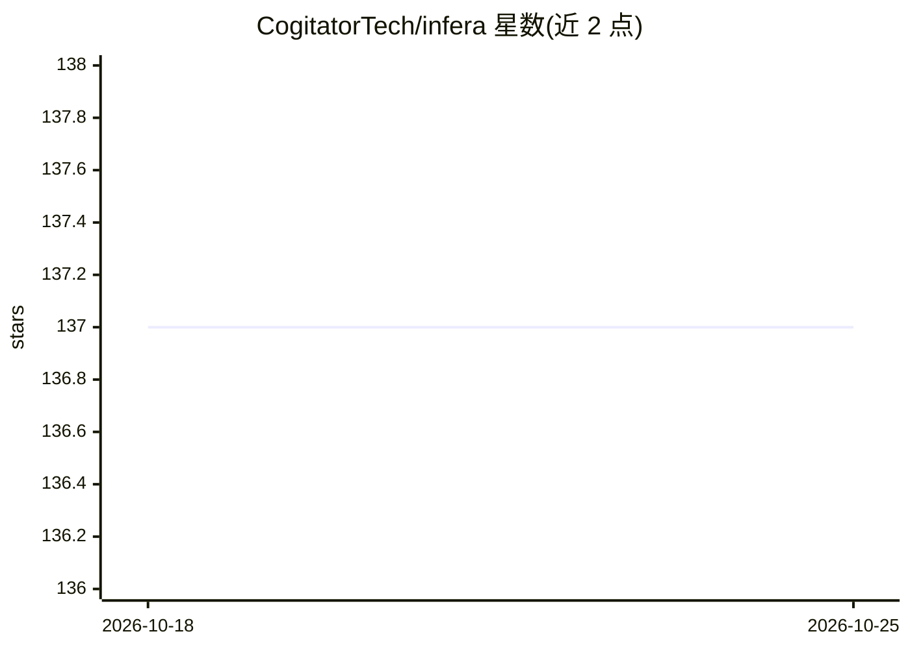

# CogitatorTech/infera

⭐ 137 · Rust · Apache-2.0 · 推送 2026-10-22 · [GitHub](https://github.com/CogitatorTech/infera) · 组织维护

**DuckDB 扩展：在 SQL 查询内直接运行 ONNX 模型推理**

用 Rust 编写的 DuckDB 扩展，以 Tract 为推理后端，支持在 SQL 查询中加载和运行 ONNX 格式机器学习模型，对 DuckDB 表中数据或原始张量执行推理，免去数据导出到 Python/R 环境再回导的流程。支持本地与远程模型、目录自动加载、单值与多值输出。可从 DuckDB 社区扩展仓库安装，也可从源码构建。README 声明项目处于早期开发阶段，可能出现 bug 与破坏性变更。

## 筛选速览

| 维度 | 判定 | 备注 |
|---|---|---|
| AI 角色 | `ai-ecosystem` | LLM/agent 周边工具 |
| 许可风险 | `permissive` | Apache-2.0 |
| 部署形态 | `None` |  |
| 模型依赖 | — | README 未给出锁定关系 |
| 硬件要求 | — | 无带数字的原话,不猜 |
| 安装摩擦 | `low` | 无编译、无系统依赖或容器化 |
| 成熟度 | `idea` | |

## 能力要点

- 在 SQL 查询内直接执行 ONNX 模型推理
- Tract 作为后端推理引擎，Rust 实现
- 支持表列或原始张量输入、单值/多值输出
- 支持模型目录自动加载与远程模型

## 适用场景

- 对数据库表内数据直接跑模型，避免数据搬运
- 用 SQL 完成批量打分或预测任务
- 结合 Hugging Face ONNX Model Zoo 中的现成模型使用

## 场景标签

`推理引擎` · 领域:训练与推理

## 证据(README 行号)

> L12: Infera is a DuckDB extension that allows you to use machine learning (ML) models directly in SQL queries to perform
> L14: It is developed in Rust and uses Tract as the backend inference engine.

## 星数曲线

2026-10-18 137 → 2026-10-25 137（+0）

---
*卡片 v1 · prompt 1.4 · 生成 2026-10-22 · 置信度 high · 依据 README sha `18184261a462` · [字段定义](../../DATASET.md)*
