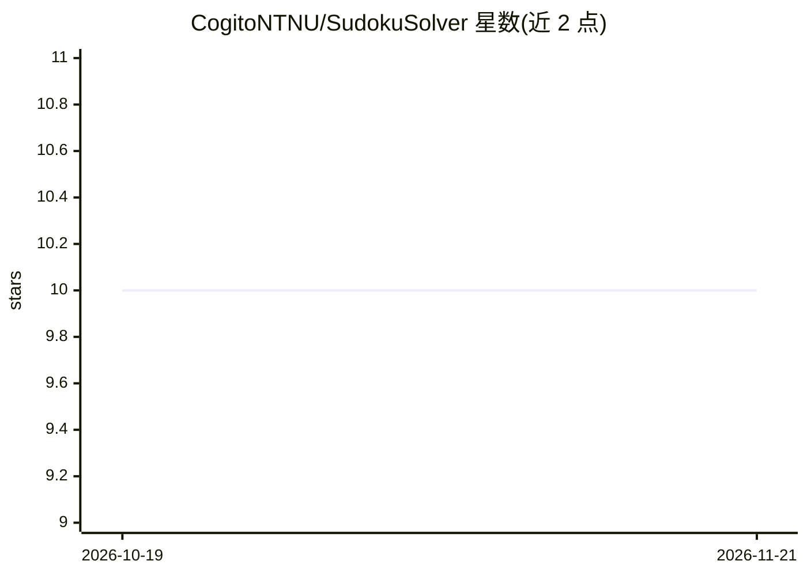

# CogitoNTNU/SudokuSolver

⭐ 10 · TypeScript · MIT · 推送 2026-09-04 · [GitHub](https://github.com/CogitoNTNU/SudokuSolver) · [官网](https://sudoku-solver-theta-wine.vercel.app) · 组织维护

**通过摄像头 AR 识别并实时求解数独的 Web 应用**

基于 Web 的 AR 数独求解应用：用高斯模糊与自适应阈值增强边缘，OpenCV.js 检测轮廓定位数独区域并投影为正方形；将数独切分为 81 格并做背景去除与膨胀处理后，交给一个用 4500 个数字自建数据集训练的 CNN 识别已有数字；再用递归回溯算法求解，并把解投影回实时摄像头画面。需要 Node 环境，开发模式使用 --experimental-https 以便 Safari 授予摄像头权限。

## 筛选速览

| 维度 | 判定 | 备注 |
|---|---|---|
| AI 角色 | `ai-native` | 本体是模型或模型工具 |
| 许可风险 | `permissive` | MIT |
| 部署形态 | `library` | 以包/库形式分发 |
| 模型依赖 | — | README 未给出锁定关系 |
| 硬件要求 | — | 无带数字的原话,不猜 |
| 安装摩擦 | `low` | 无编译、无系统依赖或容器化 |
| 成熟度 | — | 结构信号不足 |

## 能力要点

- OpenCV.js 定位数独并投影矫正
- CNN（4500 数字自建数据集）识别已填数字
- 递归回溯算法求解并将答案投影回摄像头画面
- npm 安装与运行的 Web 应用

## 适用场景

- 用摄像头实时识别并求解纸质数独
- 学习计算机视觉流水线（定位、识别、求解、投影）的实现示例
- 浏览器中以 AR 方式查看数独答案

## 场景标签

`图像视频处理` `目标检测` · 领域:感知与多模态

## 证据(README 行号)

> L24: This project is an AR sudoku solving application. Making an application like this consists mainly of solving 4 diff
> L45: Once the digits have been processed, they are sent to a CNN trained with a custom dataset containing 4500 digits. A

## 星数曲线

2026-10-19 10 → 2026-11-21 10（+0）

---
*卡片 v1 · prompt 1.4 · 生成 2026-11-20 · 置信度 high · 依据 README sha `b514dc812fe5` · [字段定义](../../DATASET.md)*
