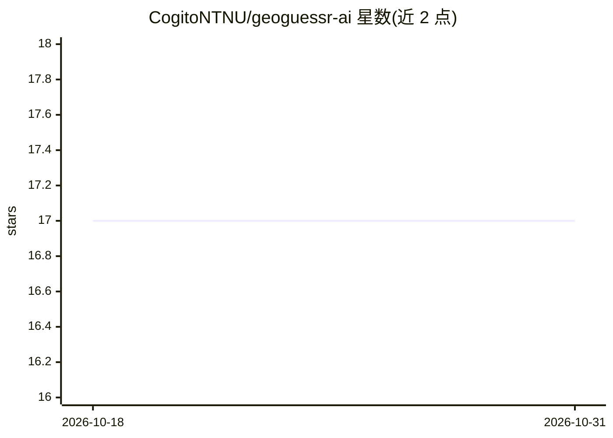

# CogitoNTNU/geoguessr-ai

⭐ 17 · Jupyter Notebook · MIT · 推送 2026-03-10 · [GitHub](https://github.com/CogitoNTNU/geoguessr-ai) · [官网](https://cogitontnu.github.io/geoguessr-ai/) · 组织维护

**从图片预测世界位置坐标的 CV 模型**

基于计算机视觉的深度学习模型，输入一张图片，输出其在世界中的位置（经纬度坐标）预测。项目由挪威 NTNU Cogito 学生团队的约 9 名成员开发，使用 Python 3.12 与 UV 管理环境，通过 git clone 源码安装，支持 Docker DevContainer 可选开发环境与 mkdocs 文档站构建，测试用 pytest 运行。README 还邀请社区按指南帮助收集训练用图片。Usage 部分的实际运行命令在 README 中留空。

## 筛选速览

| 维度 | 判定 | 备注 |
|---|---|---|
| AI 角色 | `ai-native` | 本体是模型或模型工具 |
| 许可风险 | `permissive` | MIT |
| 部署形态 | `None` |  |
| 模型依赖 | — | README 未给出锁定关系 |
| 硬件要求 | — | 无带数字的原话,不猜 |
| 安装摩擦 | `low` | 无编译、无系统依赖或容器化 |
| 成熟度 | — | 结构信号不足 |

## 能力要点

- 输入图片输出世界坐标位置预测
- UV 管理 Python 依赖环境
- 提供 pytest 测试套件与 mkdocs 文档站构建

## 适用场景

- 给定一张照片预测其拍摄地点坐标
- 参与收集图片数据帮助训练模型
- 在 CV 地理定位任务上开展学习与实验

## 场景标签

 · 领域:计算机视觉/地理定位

## 证据(README 行号)

> L17: 🌍CV-based AI model that is able to predict location (coordinates) of picture in world🌏

## 星数曲线

2026-10-18 17 → 2026-10-31 17（+0）

---
*卡片 v1 · prompt 1.4 · 生成 2026-10-30 · 置信度 high · 依据 README sha `e9b03e9e636f` · [字段定义](../../DATASET.md)*
