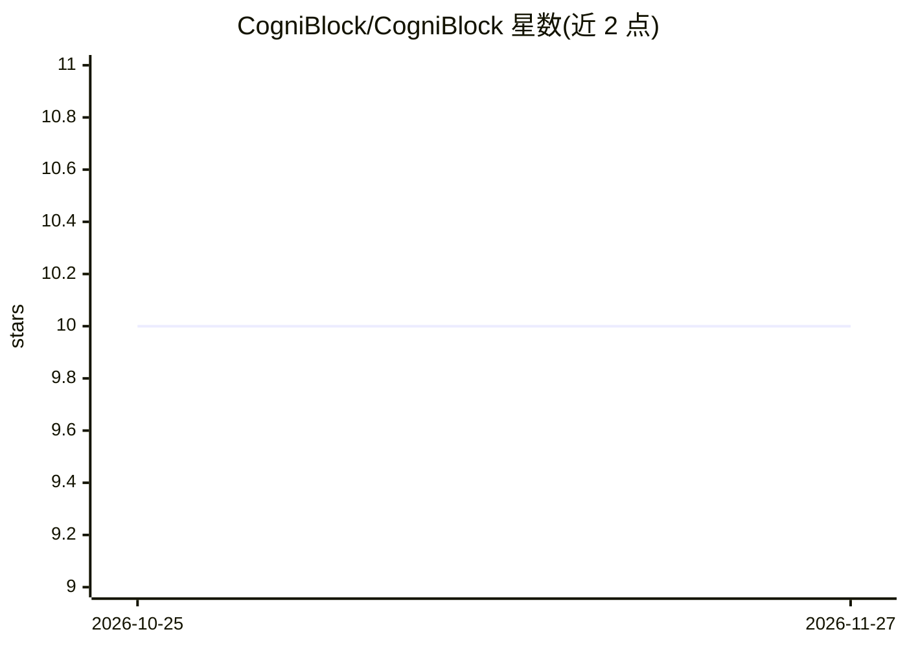

# CogniBlock/CogniBlock

⭐ 10 · HTML · 推送 2026-10-03 · [GitHub](https://github.com/CogniBlock/CogniBlock) · [官网](https://cogniblock.net/) · 组织维护

**浏览器内拖拽搭建图像处理管线的可视化 playground**

纯前端图像管线编辑器：用户拖拽 12 种区块（图像源、9 种滤镜、混合、输出）连线成有向无环图，每个区块实时预览自身输出，参数调整即时更新下游。全部计算在浏览器本地完成，无需账号，图像不上传。管线以 JSON 格式导出/导入/短链分享（仅存区块与设置）。引擎以 @cogniblock/core 包发布于 GitHub Packages，可在浏览器与 Node 18+ 运行，含 18 个测试。限制：每管线 20 KB、40 区块、80 连线。

## 筛选速览

| 维度 | 判定 | 备注 |
|---|---|---|
| AI 角色 | `ai-enhanced` | 去掉 AI 部分产品仍成立 |
| 许可风险 | `none` | — |
| 部署形态 | `library` | 以包/库形式分发 |
| 模型依赖 | — | README 未给出锁定关系 |
| 硬件要求 | — | 无带数字的原话,不猜 |
| 安装摩擦 | `low` | 无编译、无系统依赖或容器化 |
| 成熟度 | — | 结构信号不足 |

## 能力要点

- 12 个区块组成的图像管线库，Canny Edge 为完整多阶段实现（Sobel、非极大值抑制、滞后阈值）
- 每区块实时预览输出，按区块缓存结果实现增量重计算
- 短链分享仅保存区块与设置，图像永不上传
- @cogniblock/core 零依赖引擎包，浏览器与 Node 18+ 可用

## 适用场景

- 直观学习和演示高斯模糊、边缘检测等图像算法的实际效果
- 无服务器环境下快速搭建和分享图像处理流程
- 在 Node 程序中复用 @cogniblock/core 运行同样的管线

## 场景标签

`图像视频处理` · 领域:感知与多模态

## 证据(README 行号)

> L26: CogniBlock makes a pipeline something you can **see**. Instead of reading code to understand what happens to an ima
> L37: - **Real algorithms, not mock-ups.** Blur is a true Gaussian blur and Canny Edge is a full implementation: smoothin
> L223: - Blocks backed by machine-learning models that run in the browser

## 星数曲线

2026-10-25 10 → 2026-11-27 10（+0）

---
*卡片 v1 · prompt 1.4 · 生成 2026-11-20 · 置信度 mid · 依据 README sha `9caf798d0be0` · [字段定义](../../DATASET.md)*
