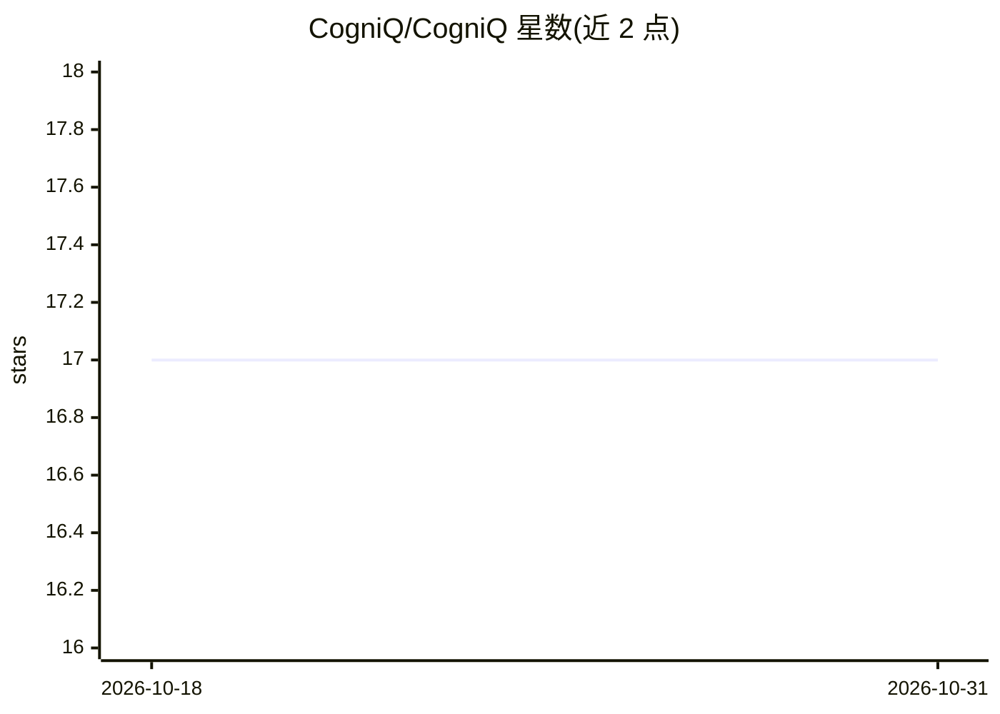

# CogniQ/CogniQ

⭐ 17 · Python · MIT · 推送 2026-07-10 · [GitHub](https://github.com/CogniQ/CogniQ) · [官网](https://www.cogniq.info/join-slack) · 个人维护

**融合 ChatGPT 与 Bing 搜索的 Slack 聊天机器人**

Slack 机器人：在频道、线程或私信中对话，将 ChatGPT 的回答与 Bing 搜索的前三条结果结合，由评估器合成带来源链接的搜索增强回答；新会话自动载入频道或线程最近约 10 条消息作为上下文。支持以 Docker 容器或 Azure Container Instances 部署，需配置 Bing、OpenAI、Anthropic、Slack 等多组 API key。README 声明项目处于活跃开发期，无稳定性保证；main.py 与 multiple_personalities.py 可作为自定义机器人的起点模板。

## 筛选速览

| 维度 | 判定 | 备注 |
|---|---|---|
| AI 角色 | `ai-native` | 本体是模型或模型工具 |
| 许可风险 | `permissive` | MIT |
| 部署形态 | `desktop` | 安装包/桌面程序 |
| 模型依赖 | locked-api |  |
| 硬件要求 | — | 无带数字的原话,不猜 |
| 安装摩擦 | `low` | 无编译、无系统依赖或容器化 |
| 成熟度 | `idea` | |

## 能力要点

- ChatGPT 回答与 Bing 搜索结果合成最终回答，附来源链接
- 多 personality 架构，可增删数据源 personality
- 线程内自动分段对话记忆，载入最近约 10 条历史消息
- 提供 Docker 容器与 Azure Container Instances 部署路径

## 适用场景

- 在 Slack 工作区中与搜索增强的 AI 机器人对话提问
- 以现有代码为模板构建自定义多数据源机器人
- 将多个 API 回答组合为带引用的综合答复

## 场景标签

`聊天机器人` · 领域:对话与助手

## 证据(README 行号)

> L6: In short, the current feature set is that you can have conversations that will be composed of responses from Bing Se
> L55: It gets its answer by performing a straight query to ChatGPT and then using an agent to draw context from Bing Sear

## 星数曲线

2026-10-18 17 → 2026-10-31 17（+0）

---
*卡片 v1 · prompt 1.4 · 生成 2026-10-30 · 置信度 high · 依据 README sha `e24db0514669` · [字段定义](../../DATASET.md)*
