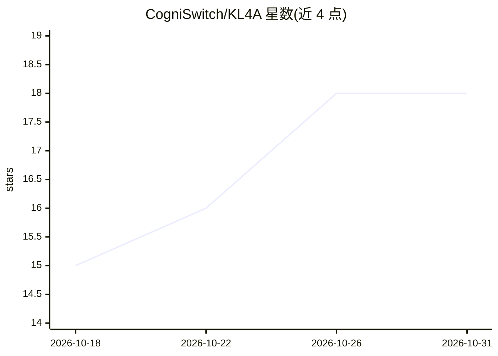

# CogniSwitch/KL4A

⭐ 18 · Rust · Apache-2.0 · 推送 2026-10-12 · [GitHub](https://github.com/CogniSwitch/KL4A) · [官网](https://cogniswitch.github.io/KL4A/) · 组织维护

**从 SOP 与代码仓库构建带证据的知识包，经 MCP 供 agent 引用**

面向依赖 SOP 的团队和开发者，提供两条流水线：SOP Knowledge Bundle 将 PDF/DOCX/文本规程规范化为 Markdown、切分章节、抽取带证据链接的知识条目，由人工逐条 approve/reject；Code Knowledge Bundle 将 Python/COBOL 仓库解析为文件、符号、关系与任务上下文。产物为纯文件（Markdown+YAML），可 git diff 与版本化，无数据库。通过 CLI 与只读 stdio MCP 服务器暴露给 agent，静态挖掘路径无需 LLM provider。桌面应用（Tauri）仅支持 SOP 流程，当前版本为 v0.0.2-alpha，构建未签名。

## 筛选速览

| 维度 | 判定 | 备注 |
|---|---|---|
| AI 角色 | `ai-ecosystem` | LLM/agent 周边工具 |
| 许可风险 | `permissive` | Apache-2.0 |
| 部署形态 | `desktop` | 安装包/桌面程序 |
| 模型依赖 | — | README 未给出锁定关系 |
| 硬件要求 | — | 无带数字的原话,不猜 |
| 安装摩擦 | `low` | 无编译、无系统依赖或容器化 |
| 成熟度 | `idea` | |

## 能力要点

- SOP→规范化→抽取→人工审核（带 rationale）→导出的完整流水线
- 知识条目携带到源句的字节范围证据；LLM 无法逐字定位时标记 span_status 而非编造
- 纯文件 OKF 知识包，无数据库，可通过 git 审查与版本化
- CLI 与只读 stdio MCP 服务器（knowledge.search、agent.context 等工具）双通道访问

## 适用场景

- 把公司政策/规程转为 agent 可引用且可审计的知识层
- 让 MCP 客户端（如 Claude Code）基于已审核知识回答，未命中时返回空而非猜测
- 为代码仓库生成结构感知的任务上下文供 agent 使用

## 场景标签

`知识图谱` `知识库管理` · 领域:知识与检索

## 证据(README 行号)

> L15: - Exposes both bundle types through a CLI and a read-only MCP interface for agents.
> L208: |`sopkb-mcp <bundle_dir>`|Expose the same read-only tools over MCP for any MCP-capable agent|
> L211: |`kl4a --use codekb mcp serve <bundle_dir>`|Expose read-only CodeKB tools over stdio MCP|

## 星数曲线

2026-10-18 15 → 2026-10-31 18（+3）

---
*卡片 v1 · prompt 1.4 · 生成 2026-10-29 · 置信度 high · 依据 README sha `2047d8a7ab9b` · [字段定义](../../DATASET.md)*
