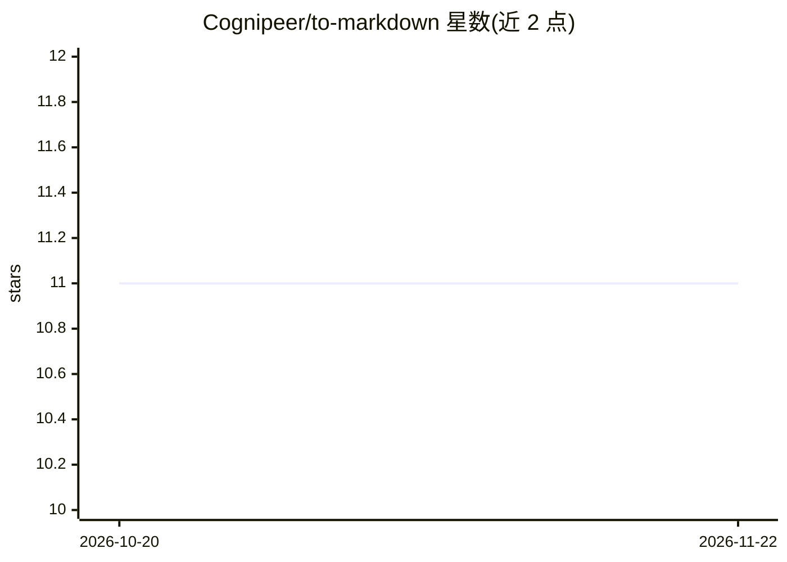

# Cognipeer/to-markdown

⭐ 11 · JavaScript · MIT · 推送 2026-11-13 · [GitHub](https://github.com/Cognipeer/to-markdown) · [官网](https://docs.cognipeer.com/to-markdown/) · 组织维护

**面向 LLM/RAG 摄取的多格式文件转 Markdown 的 TypeScript 库**

TypeScript 工具库，将 PDF、DOC/DOCX、Excel、PowerPoint、HTML、EPUB、notebook、图像等格式转换为 Markdown，定位为 LLM 与 RAG 的摄取前处理环节。提供 Promise 风格的 convertToMarkdown API、Buffer/base64/文件路径输入、每页 OCR（含多 provider）与带页面/耗时报告的详细输出；默认使用本地 tesseract.js，OCR 需 opt-in。二进制 Word .doc 仅支持 Word 97-2003，输入默认限 25 MiB，且不提取图像与嵌入对象。

## 筛选速览

| 维度 | 判定 | 备注 |
|---|---|---|
| AI 角色 | `ai-ecosystem` | LLM/agent 周边工具 |
| 许可风险 | `permissive` | MIT |
| 部署形态 | `library` | 以包/库形式分发 |
| 模型依赖 | local-ok | 支持本地模型 |
| 硬件要求 | — | 无带数字的原话,不猜 |
| 安装摩擦 | `low` | 无编译、无系统依赖或容器化 |
| 成熟度 | — | 结构信号不足 |

## 能力要点

- 支持 PDF/DOCX/PPTX/XLSX/HTML/CSV/EPUB/图像等多格式转 Markdown
- OCR 支持本地 tesseract 与 openai/anthropic/ollama/azure 等 VLM provider
- PDF 逐页 OCR 模式（auto/auto-page/always/never）与自定义 handler 回调
- convertToMarkdownDetailed 输出页面、图像与计时报告

## 适用场景

- 为 RAG 知识库批量把企业文档转换为 Markdown
- 处理扫描版 PDF，用 OCR 抽取文本供 LLM 摄取
- 在 Node/TypeScript 管道中做统一的文档前处理

## 场景标签

`文档解析` · 领域:知识与检索

## 证据(README 行号)

> L3: **Convert PDF, Word, Excel, PowerPoint, HTML, EPUB, notebooks, images and more to clean Markdown, ready for LLM and 
> L19: - 🔎 **OCR Support**: Extract text from scanned PDFs (per page), images, multi-page TIFF and images embedded in DOCX
> L151: - 🌐 Added OCR provider support: `tesseract`, `openai-vlm`, `anthropic-vlm`, `ollama-vlm`, `azure-vision`, `custom-

## 星数曲线

2026-10-20 11 → 2026-11-22 11（+0）

---
*卡片 v1 · prompt 1.4 · 生成 2026-11-19 · 置信度 high · 依据 README sha `62cd935ffd96` · [字段定义](../../DATASET.md)*
