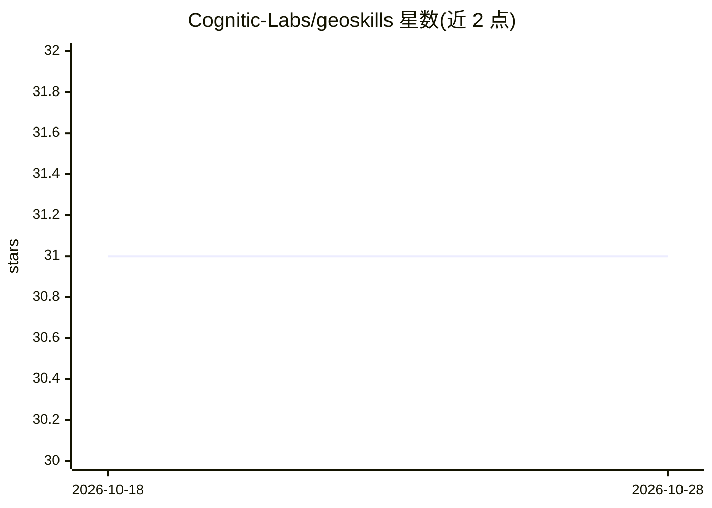

# Cognitic-Labs/geoskills

⭐ 31 · JavaScript · Apache-2.0 · 推送 2026-10-01 · [GitHub](https://github.com/Cognitic-Labs/geoskills) · [官网](https://aivsrank.com) · 组织维护

**面向网站运营者的 GEO Agent 技能套件：审计与修复 AI 可见性**

开源 Agent Skills 套件，提供 8 个技能对网站在 AI 搜索引擎中的可见性做诊断、修复与监测：geo-audit 输出 0-100 综合 GEO 评分（四维度加权）与修复计划，配套内容改写、JSON-LD schema 生成、llms.txt 创建、竞品对比与趋势监测技能，另含 GSC/Bing/GA4 与 Bing AI 引用数据分析。审计技能检查 10 种 AI 爬虫的访问情况，GEO 类技能无需 API key。通过 npx skills 或 git clone 安装到 AgentSkills 兼容的 agent 中运行。

## 筛选速览

| 维度 | 判定 | 备注 |
|---|---|---|
| AI 角色 | `ai-ecosystem` | LLM/agent 周边工具 |
| 许可风险 | `permissive` | Apache-2.0 |
| 部署形态 | `library` | 以包/库形式分发 |
| 模型依赖 | — | README 未给出锁定关系 |
| 硬件要求 | — | 无带数字的原话,不猜 |
| 安装摩擦 | `low` | 无编译、无系统依赖或容器化 |
| 成熟度 | — | 结构信号不足 |

## 能力要点

- geo-audit 输出 0-100 GEO 评分与按严重度排序的修复计划
- 检查 10 种 AI 爬虫（GPTBot、ClaudeBot、PerplexityBot 等）的访问情况
- geo-fix 系列：内容改写、JSON-LD schema 生成、llms.txt 创建
- GEO 审计技能无需 API key 即可运行

## 适用场景

- 诊断我的网站为什么不被 AI 搜索引擎引用
- 生成结构化数据与 llms.txt 提升 AI 可读性
- 与竞品对比 GEO 评分并跟踪随时间的变化
- 分析 GSC/Bing/GA4 数据寻找 SEO 机会

## 场景标签

`数据分析` · 领域:效率与自动化

## 证据(README 行号)

> L8: geoskills is an open-source Agent Skill suite that audits, fixes, and monitors your website's visibility across AI-p
> L10: Compatible with Claude Code, OpenCode, OpenClaw, Codex CLI, Cursor, GitHub Copilot, and any AgentSkills-compatible 

## 星数曲线

2026-10-18 31 → 2026-10-28 31（+0）

---
*卡片 v1 · prompt 1.4 · 生成 2026-10-26 · 置信度 high · 依据 README sha `62c0268cf5f7` · [字段定义](../../DATASET.md)*
