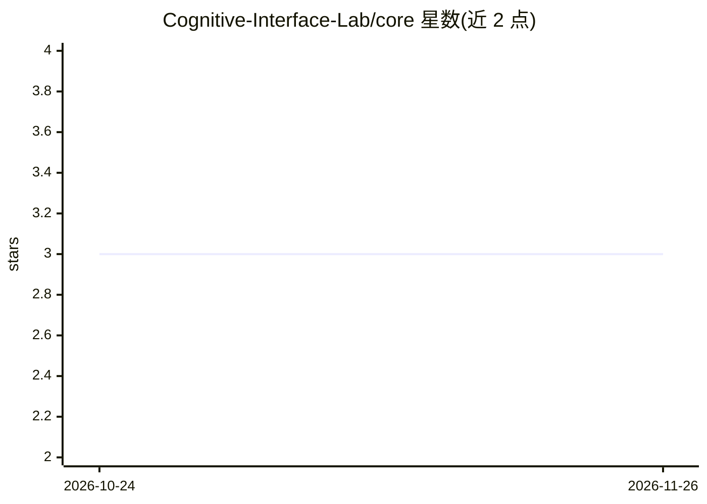

# Cognitive-Interface-Lab/core

⭐ 3 · TypeScript · MIT · 推送 2026-10-21 · [GitHub](https://github.com/Cognitive-Interface-Lab/core) · 组织维护

**给 AI 产品开发者的 TypeScript 模型网关：多 provider 统一接口+回退路由**

TypeScript 编写的 AI 产品基础组件：通过 @core/models 提供统一 provider 接口、凭据存储与故障回退路由，@core/runtime 执行带工具调用与 MCP 的回合，@core/graph 在追加式事件日志上支持会话图的分支、合并与重放。可从终端以 core ask/chat 命令使用，可在 Node 代码中按包引入，或通过 createCoreHandler 把 HTTP API 挂载进自己的服务器；core serve 仅监听 127.0.0.1，支持网站六字符配对机制让访客用自己的密钥。需要 Node 22+ 与 pnpm，从源码构建，尚未发布到 npm。

## 筛选速览

| 维度 | 判定 | 备注 |
|---|---|---|
| AI 角色 | `ai-ecosystem` | LLM/agent 周边工具 |
| 许可风险 | `permissive` | MIT |
| 部署形态 | `library` | 以包/库形式分发 |
| 模型依赖 | local-ok | 支持本地模型 |
| 硬件要求 | — | 无带数字的原话,不猜 |
| 安装摩擦 | `low` | 无编译、无系统依赖或容器化 |
| 成熟度 | `idea` | |

## 能力要点

- 统一 provider 接口+故障回退路由（@core/models）
- 可分支、合并、重放的会话图（追加式事件日志）
- 本地 HTTP API（OpenAPI 3.1）可挂载进应用，含网站配对机制
- core ask 支持 --schema/--json 等 5 个脚本调用选项

## 适用场景

- 为应用接入多家模型 provider 并自动回退到下一个
- 在本地运行 HTTP API 供自己的前端调用模型
- 需要分支、重放会话流程的对话应用开发
- 让网站访客用自己的 API key 在其本机调用模型

## 场景标签

`模型网关` `Agent 框架` · 领域:Agent 开发

## 证据(README 行号)

> L3: An open TypeScript backbone for products that use AI. It gives you one interface to many model providers, with fallb
> L20: |`@core/models`|Model gateway: one provider interface, registry, credential stores, fallback router|

## 星数曲线

2026-10-24 3 → 2026-11-26 3（+0）

---
*卡片 v1 · prompt 1.4 · 生成 2026-11-22 · 置信度 mid · 依据 README sha `31e512e719b9` · [字段定义](../../DATASET.md)*
