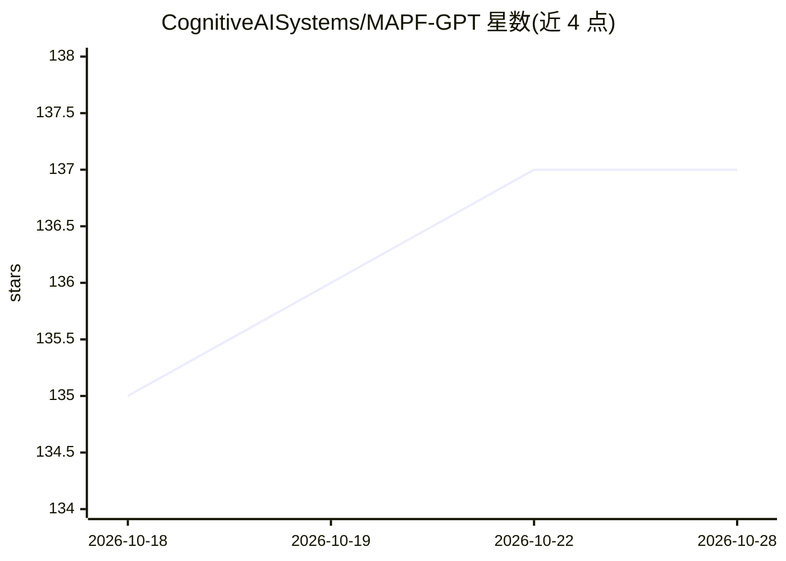

# CognitiveAISystems/MAPF-GPT

⭐ 137 · C++ · MIT · 推送 2026-04-23 · [GitHub](https://github.com/CognitiveAISystems/MAPF-GPT) · 组织维护

**多智能体路径规划（MAPF）的模仿学习 Transformer 模型**

AAAI-2025 论文官方实现：基于 Transformer 的深度学习模型，通过模仿 LaCAM 专家轨迹训练，在部分可观测环境下直接生成各智能体动作，无需启发式或智能体间通信。提供 2M/6M/85M 三种规模模型（自动从 Hugging Face 下载），支持在 POGEMA 基准上评测，附 1B 训练数据集的下载与生成脚本及多 GPU DDP 训练脚本。推荐 GPU 环境，小模型可 CPU 运行，Apple Silicon 支持 mps 设备。

## 筛选速览

| 维度 | 判定 | 备注 |
|---|---|---|
| AI 角色 | `ai-native` | 本体是模型或模型工具 |
| 许可风险 | `permissive` | MIT |
| 部署形态 | `self-host` | docker 或自建部署 |
| 模型依赖 | — | README 未给出锁定关系 |
| 硬件要求 | — | 无带数字的原话,不猜 |
| 安装摩擦 | `low` | 无编译、无系统依赖或容器化 |
| 成熟度 | — | 结构信号不足 |

## 能力要点

- 部分可观测下无启发式、无通信的动作生成
- 2M/6M/85M 三种模型规模，权重自动下载
- 提供 1B 训练数据集的下载与自行生成脚本
- DDP 多 GPU 训练与 POGEMA 基准评测脚本

## 适用场景

- 在 POGEMA 基准地图上评测 MAPF 模型
- 复现论文或在大规模多智能体路径规划场景中直接使用模型
- 基于提供的脚本与数据集训练或微调自己的 MAPF-GPT

## 场景标签

`模型评测` `模型训练` · 领域:评测与运维

## 证据(README 行号)

> L1: # MAPF-GPT: Imitation Learning for Multi-Agent Pathfinding at Scale
> L13: - `example.py` - an example of code to run the MAPF-GPT approach.
> L72: To train MAPF-GPT, we generated a training dataset consisting of 1 billion tensor-action pairs (specifically, 1,000

## 星数曲线

2026-10-18 135 → 2026-10-28 137（+2）

---
*卡片 v1 · prompt 1.4 · 生成 2026-10-22 · 置信度 high · 依据 README sha `6b68b7256880` · [字段定义](../../DATASET.md)*
