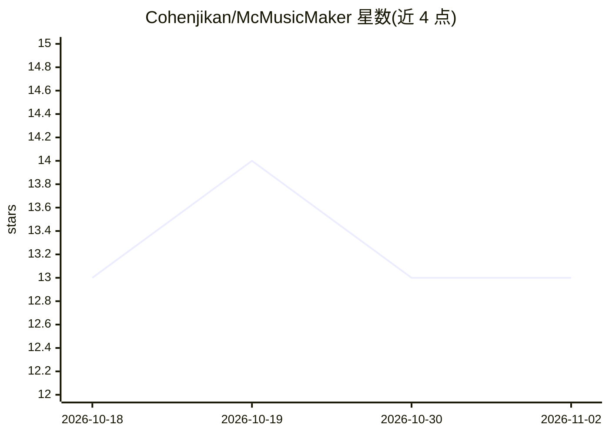

# Cohenjikan/McMusicMaker

⭐ 13 · Python · NOASSERTION · 推送 2026-10-17 · [GitHub](https://github.com/Cohenjikan/McMusicMaker) · 个人维护 · 中文 README

**AI agent 技能包：把歌曲变成 Minecraft 音符盒红石音乐机**

面向使用 Codex、Claude Code 等可读写文件 agent 的技能仓库：用户提供 MIDI（或 MP3/WAV/FLAC）与 Minecraft Java 存档，agent 分析歌曲、分配声部、生成数据包/资源包/模组，并产出可双击安装的部署脚本。支持 5 种机型（原地紧凑/S 形/直线/自定义/多轨并行），附浏览器打开的走线设计器与命令方块关键帧编辑器。限制：推荐 Windows 与 Java 1.21–1.21.10，基岩版不支持，播放需手敲 /tick rate 80。

## 筛选速览

| 维度 | 判定 | 备注 |
|---|---|---|
| AI 角色 | `ai-ecosystem` | LLM/agent 周边工具 |
| 许可风险 | `none` | NOASSERTION |
| 部署形态 | `None` |  |
| 模型依赖 | — | README 未给出锁定关系 |
| 硬件要求 | — | 无带数字的原话,不猜 |
| 安装摩擦 | `medium` | 含编译或系统依赖之一 |
| 成熟度 | — | 结构信号不足 |

## 能力要点

- 从 MIDI 到数据包/资源包/模组的红石音乐机自动构建流程
- 5 种机型可选或由 agent 按歌曲特征推荐
- 浏览器版走线设计器与命令方块关键帧编辑器
- MP3/WAV/FLAC 可由 agent 先转 MIDI（转录有错音漏音）

## 适用场景

- 我在 Minecraft 里用音符盒还原一首歌
- 我想让 AI agent 全程代劳红石音乐机的搭建与安装
- 我想自定义音乐机走线或给歌曲配命令方块演出

## 场景标签

 · 领域:游戏/音乐创作

## 证据(README 行号)

> L3: 把一首歌交给 AI agent，在 Minecraft 里搭成一台真正会演奏的音符盒红石机器。
> L33: 下载或 clone **完整仓库**，然后用 Codex、Claude Code 或其他可以读写文件的 agent 打开这个文件夹。

## 星数曲线

2026-10-18 13 → 2026-11-02 13（+0）

---
*卡片 v1 · prompt 1.4 · 生成 2026-10-31 · 置信度 high · 依据 README sha `d299e0d28182` · [字段定义](../../DATASET.md)*
