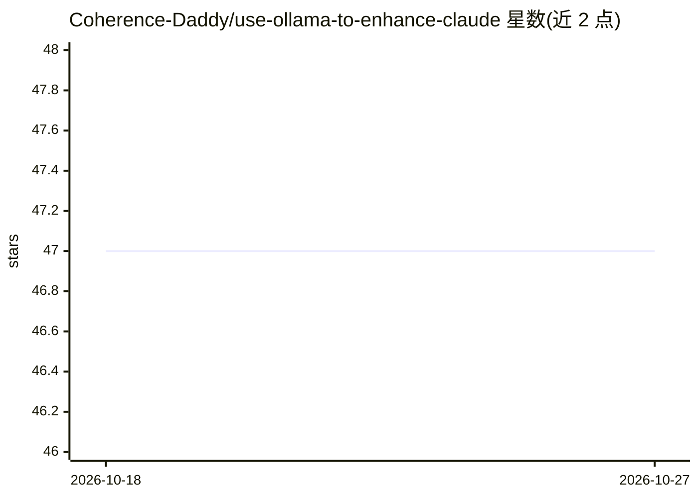

# Coherence-Daddy/use-ollama-to-enhance-claude

⭐ 47 · HTML · MIT · 推送 2026-04-29 · [GitHub](https://github.com/Coherence-Daddy/use-ollama-to-enhance-claude) · [官网](https://coherencedaddy.com/tutorials/use-ollama-to-enhance-claude) · 组织维护

**教程仓库：用 Ollama 为 Claude Code 分流以降低账单**

一份 21 页的可视化教程（自包含 HTML，无需构建），指导用户将 Anthropic Claude Desktop 与经 Ollama 路由的 Claude Code 终端会话搭配使用：策略与架构工作留在 Claude Pro，重复性编辑、lint、批量文件操作等重活交给本地或云端的免费开源模型（Gemma、Qwen、DeepSeek 等）。提供可粘贴的提示词，由 Claude 自动检测操作系统、完成安装与路由配置并验证两个引擎；支持 macOS、Windows+WSL2、Linux。由 Coherence Daddy（自称 508(c)(1)(A) 组织）维护，MIT 许可。

## 筛选速览

| 维度 | 判定 | 备注 |
|---|---|---|
| AI 角色 | `ai-knowledge` | 知识聚合/清单类 |
| 许可风险 | `permissive` | MIT |
| 部署形态 | `None` |  |
| 模型依赖 | local-ok | 支持本地模型 |
| 硬件要求 | — | 无带数字的原话,不猜 |
| 安装摩擦 | `low` | 无编译、无系统依赖或容器化 |
| 成熟度 | — | 结构信号不足 |

## 能力要点

- 21 页自包含 HTML 教程，无构建步骤，浏览器直接打开
- 一段可粘贴提示词完成约 98% 的安装与配置，自动检测操作系统
- 双引擎对照表：Claude Desktop 负责策略，Ollama 路由的 Claude Code 负责重复性任务

## 适用场景

- 我想降低 Claude Code 的月度用量消耗
- 我需要在终端用本地模型做 lint、重构和批量文件操作
- 我想要一份按操作系统区分的 Ollama 接入 Claude Code 步骤说明

## 场景标签

`教程课程` · 领域:学习与行业

## 证据(README 行号)

> L10: A 21-slide visual walkthrough that pairs your **Anthropic Claude Desktop** app with an **Ollama-backed Claude Code*
> L13: - **Copy-paste prompt** — drop one block into Claude and it does ~98% of the setup for you

## 星数曲线

2026-10-18 47 → 2026-10-27 47（+0）

---
*卡片 v1 · prompt 1.4 · 生成 2026-10-25 · 置信度 high · 依据 README sha `0b35425205d7` · [字段定义](../../DATASET.md)*
