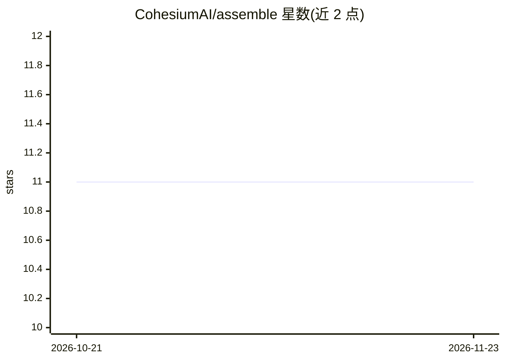

# CohesiumAI/assemble

⭐ 11 · JavaScript · MIT · 推送 2026-07-10 · [GitHub](https://github.com/CohesiumAI/assemble) · [官网](https://assemble.cohesium.ai) · 组织维护

**为 AI 编码助手生成多平台角色配置的命令行工具**

配置生成器：维护 34 个 agent 定义、15 个多步工作流与 28 个技能的平台无关源文件，通过一条命令编译为 Cursor、Claude Code、Copilot 等 21 个平台的原生配置格式（.cursorrules、CLAUDE.md 等）。运行时由各 IDE 内的 LLM 读取配置执行；支持 /go 单命令入口、Jarvis 编排器路由专家、Kanban 板式执行、可选的联网核验协议与反从众结构的固定唱反调角色。无运行时、无守护进程、无 SDK，MIT 许可，当前为 beta 版本。

## 筛选速览

| 维度 | 判定 | 备注 |
|---|---|---|
| AI 角色 | `ai-ecosystem` | LLM/agent 周边工具 |
| 许可风险 | `permissive` | MIT |
| 部署形态 | `library` | 以包/库形式分发 |
| 模型依赖 | — | README 未给出锁定关系 |
| 硬件要求 | — | 无带数字的原话,不猜 |
| 安装摩擦 | `low` | 无编译、无系统依赖或容器化 |
| 成熟度 | `idea` | |

## 能力要点

- 34 个 agent 定义编译为 21 个平台的原生配置文件
- 单一配置源，换 IDE 后重新生成即可
- /go 命令 + Jarvis 编排器按复杂度选择并串联专家
- 固定唱反调角色与升级否决机制的结构化分歧设计

## 适用场景

- 独立开发者用一套配置在多个 AI IDE 中获得专家分工协作
- 团队统一维护 AI 助手行为配置并分发到不同平台
- 复杂任务用看板模式按依赖并行推进工单

## 场景标签

`提示工程` · 领域:Agent 开发

## 证据(README 行号)

> L41: It is a **configuration generator**. It maintains 34 agent definitions, 15 multi-step workflows, and 28 reusable sk
> L43: The result: your LLM stops being a generic assistant and starts operating as a coordinated team. An architect who t

## 星数曲线

2026-10-21 11 → 2026-11-23 11（+0）

---
*卡片 v1 · prompt 1.4 · 生成 2026-11-19 · 置信度 mid · 依据 README sha `72dfd3b2c35d` · [字段定义](../../DATASET.md)*
