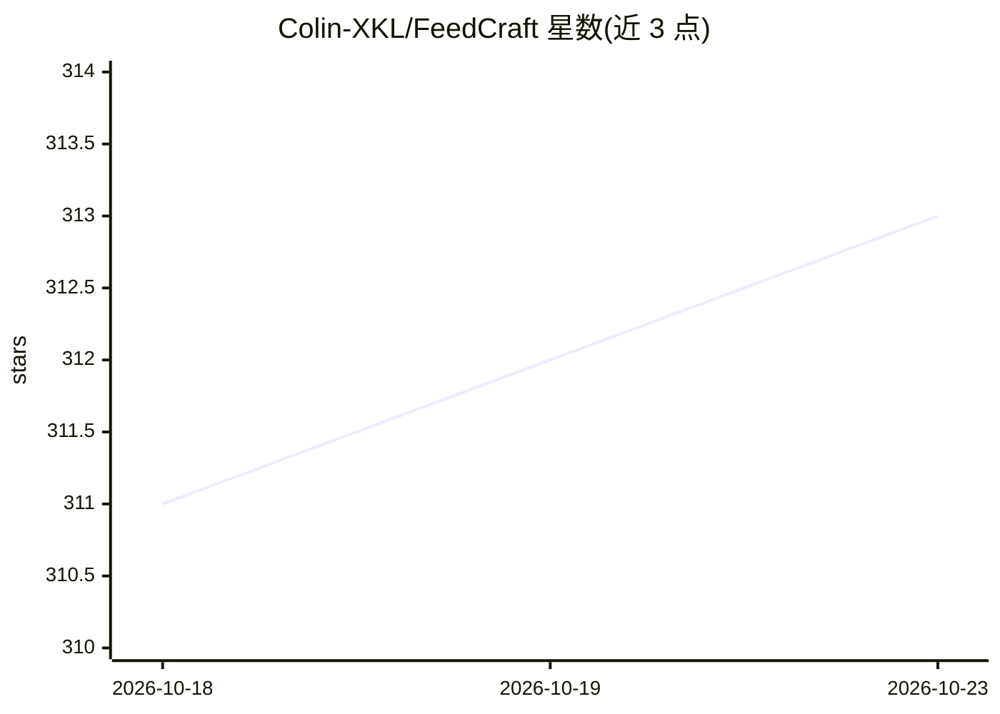

# Colin-XKL/FeedCraft

⭐ 313 · Go · GPL-3.0 · 推送 2026-10-22 · [GitHub](https://github.com/Colin-XKL/FeedCraft) · [官网](https://feed-craft.colinx.one/start.html) · 个人维护 · 中文 README

**RSS 中间件：为订阅源加全文、翻译、AI 摘要与筛选**

可自部署的 RSS 源处理中间件，与现有任意 RSS 阅读器协同使用：通过在原 RSS 地址前加前缀的便携模式或后台 dock 高级模式，对源执行提取全文、模拟浏览器渲染抓取、接入 OpenAI 接口兼容 LLM 做翻译/摘要/排版美化/软文过滤，支持自定义 prompt；内置可视化 RSS 生成器，可将网页、JSON API、搜索结果转为 RSS。处理单元按 AtomCraft/FlowCraft/Recipe 组合，输出为可订阅的新 RSS 地址。通过 Docker Compose 自部署，控制台默认账号 admin，GPLv3 许可。

## 筛选速览

| 维度 | 判定 | 备注 |
|---|---|---|
| AI 角色 | `ai-enhanced` | 去掉 AI 部分产品仍成立 |
| 许可风险 | `viral` | GPL-3.0 |
| 部署形态 | `self-host` | docker 或自建部署 |
| 模型依赖 | — | README 未给出锁定关系 |
| 硬件要求 | — | 无带数字的原话,不猜 |
| 安装摩擦 | `low` | 无编译、无系统依赖或容器化 |
| 成熟度 | — | 结构信号不足 |

## 能力要点

- 便携模式：原 RSS 地址加前缀即用，无需配置阅读器
- 接入 OpenAI 接口兼容 LLM 做翻译、摘要、自然语言筛选，prompt 可自定义
- HTML/JSON/Search to RSS 可视化生成器
- AtomCraft/FlowCraft/Recipe 三级组合定义处理流水线

## 适用场景

- 订阅英文源时自动翻译标题或内容，便于略读
- 为只有摘要的源自动提取全文
- 让 AI 为知乎日报等源生成摘要并直接订阅
- 把网页或 JSON API 转成 RSS 订阅源

## 场景标签

`AI 写作` `网页抓取` · 领域:效率与自动化

## 证据(README 行号)

> L20: It can serve as middleware to handle your RSS feeds; you can use it to extract the main text, perform intelligent t
> L30: - AI Power, 可以接入 Open AI 接口兼容的 LLM 对 RSS 进行处理, 可自定义 prompt

## 星数曲线

2026-10-18 311 → 2026-10-23 313（+2）

---
*卡片 v1 · prompt 1.4 · 生成 2026-10-21 · 置信度 high · 依据 README sha `3b50c597bbbb` · [字段定义](../../DATASET.md)*
