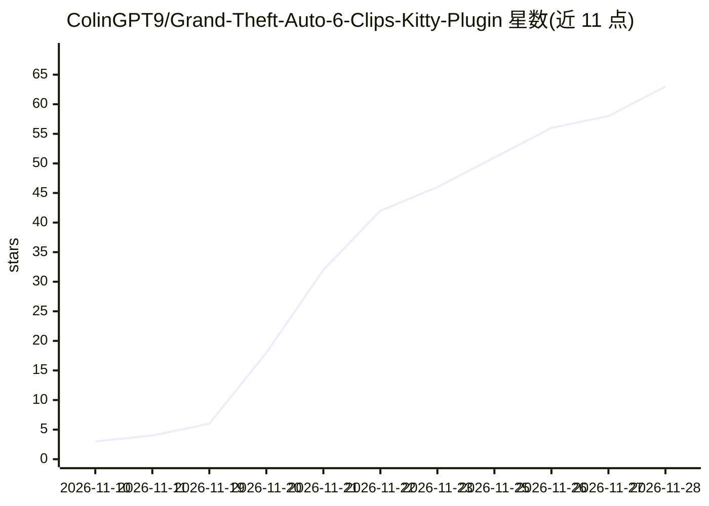

# ColinGPT9/Grand-Theft-Auto-6-Clips-Kitty-Plugin

⭐ 63 · Python · MIT · 推送 2026-11-21 · [GitHub](https://github.com/ColinGPT9/Grand-Theft-Auto-6-Clips-Kitty-Plugin) · 个人维护

**GTA 直播流高光片段检测的 Clips Kitty 插件**

面向 Clips Kitty 主程序的 Python SDK 插件，从 GTA V/GTA 风格直播转录文本中检测追逐、撞击、特技、战斗、任务结局等事件线索，结合音频/画面测量与观众提名，输出可解释的剪辑建议，支持 find/understand/rate/edit 四个阶段。规则未命中时可调用已安装的本地模型给出对话式建议。依赖宿主提供转录证据；不识别未转录事件，GTA VI 玩法准确度未经验证。

## 筛选速览

| 维度 | 判定 | 备注 |
|---|---|---|
| AI 角色 | `ai-native` | 本体是模型或模型工具 |
| 许可风险 | `permissive` | MIT |
| 部署形态 | `None` |  |
| 模型依赖 | local-ok | 支持本地模型 |
| 硬件要求 | — | 无带数字的原话,不猜 |
| 安装摩擦 | `medium` | 含编译或系统依赖之一 |
| 成熟度 | — | 结构信号不足 |

## 能力要点

- 从转录文本检测追逐、撞击、特技、战斗、任务结局等 8 类事件线索
- 输出分数构成、观测模态、去重原因与审查警告的可解释建议
- 规则未命中时用已安装本地模型生成有出处的对话式建议
- 251 项本地测试通过，附演示复现脚本

## 适用场景

- 为 GTA V/GTA RP 直播流自动生成可审查的高光剪辑建议
- 发布到 Twitch/YouTube Shorts/TikTok/Reels 前筛选精彩片段
- 按类别与阈值配置只保留特定事件类型

## 场景标签

`图像视频处理` · 领域:感知与多模态

## 证据(README 行号)

> L4: targeting **GTA V (GTA 5)** gameplay and **GTA VI (GTA 6)** support. It finds explicit
> L33: - Supports **find**, **understand**, **rate**, and opt-in **edit** suggestions.
> L48: GTA VI is a development target; GTA VI gameplay accuracy has not been tested.

## 星数曲线

2026-11-10 3 → 2026-11-28 63（+60）

---
*卡片 v1 · prompt 1.4 · 生成 2026-11-20 · 置信度 high · 依据 README sha `ca4965658f1f` · [字段定义](../../DATASET.md)*
